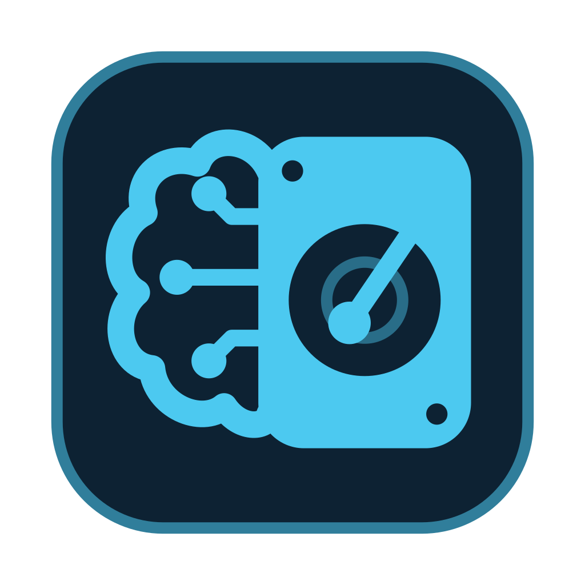

<p align="center">
  
</p>

<h1 align="center">CCM — Context Memory Manager</h1>

<p align="center">
  A self-hosted file manager for the memory folders, prompts and private files of your LLM tools.<br>
  Encrypted, versioned and backed up on your own drives. Runs fully offline.
</p>

<p align="center">
  <a href="LICENSE"></a>
  
  
  
</p>


AI agents and chat tools keep their memory in plain folders: personas, project knowledge, scratchpads, notes,
datasets. CCM gives those folders a proper home. Browse and edit them in one app, mark folders as memories, lock or
encrypt the sensitive ones, keep a history of every change, and back everything up to a USB stick or external drive.
Nothing leaves your machine: there is no account, no cloud and no telemetry.

CCM runs two ways:

- **Desktop app** for macOS, Windows and Linux (Electron). Your files stay where they are on your computer.
- **Server** on an Ubuntu machine on your network (systemd service), opened from any browser on the LAN, with user
  accounts and HTTPS.

## Features

### Explorer and editors

A file tree and a file pane, side by side. Markdown opens formatted and edits in a rich editor or as source; code opens
with syntax colours in a code editor; images, PDFs and CSV/TSV tables have their own viewers. Drag and drop, copy and
paste across drives, upload, download as zip, and a trash you can restore from. Hide the tree (<kbd>⌘</kbd>/<kbd>Ctrl</kbd>+<kbd>\\</kbd>)
to give the editor the whole window.


| Markdown editor | Code editor |
|---|---|
|  |  |
| **CSV and TSV tables** | **Images** |
|  |  |

### Quick search

Press <kbd>⌘</kbd>/<kbd>Ctrl</kbd>+<kbd>K</kbd> to switch drives, jump to a page, or find any file or folder by name.


### Memory folders

Turn any folder into a **memory** with a name, a colour and a description, or start one from a template (LLM persona,
project knowledge, agent scratchpad). Each memory gets an overview with its size, recent files and quick actions.
Folders can be made **view-only** or **locked**, so an agent or a slip of the mouse can't change them.

| Memory overview | Protection |
|---|---|
|  |  |

### Encryption

Encrypt a folder with AES-256-GCM. Its key lives in a key file that you keep, for example on a USB stick. Files stay
encrypted on disk and in every backup; unlock the folder with its key file to read and edit them inside CCM, and it
locks again on its own.

| Encryption wizard | Unlocking a folder |
|---|---|
|  |  |

### Version history

Turn on versioning for a folder and CCM keeps a Git history of it: every save is a version you can compare and restore,
with undo and redo, named snapshots, and nothing to learn about Git.


### Backups

Back up any folder to another drive: copy, mirror, or dated snapshots. Profiles can run as soon as a drive is plugged
in, interrupted backups resume where they stopped, and a live picture shows your computer, its drives and every running
transfer.

| Backup topology | A running transfer |
|---|---|
|  |  |

### Users and security

Admin, editor and viewer accounts with per-storage access, sign-in lockout, auto-lock, a password check before
sensitive actions, and HTTPS on the server. Drives (internal folders, external disks and USB sticks) appear and
disappear live, and can be ejected from CCM.

| Users | Security |
|---|---|
|  |  |

## Guides

Two illustrated guides cover installing and using CCM, written for non-technical users:

- [Desktop Guide](docs/guides/desktop-guide.md): install the app, storages, memories, encryption, versions, backups.
- [Server Guide](docs/guides/server-guide.md): install on Ubuntu, HTTPS, users, drives, updates and troubleshooting.

`npm run docs:pdf` builds both as PDFs (`dist/docs/`); the desktop app and the server package include them.

## Getting started

Requires **Node.js 22** (see `.nvmrc`).

```bash
npm install
npx playwright install chromium   # once: used to build the PDF guides and the app icons
```

### Run from source

```bash
npm run dev      # http://127.0.0.1:7420, data in .ccm-dev-data/
```

The first visit opens the setup wizard. In this (server) mode it asks for a one-time setup code, which the terminal
prints (`[ccm] first-run setup code: …`) and `.ccm-dev-data/setup-code` holds. To browse a folder, list it in
`.ccm-dev-data/config.json` and restart:

```json
{ "storageRoots": [{ "path": "/absolute/path/to/a/folder", "label": "My files" }] }
```

Plugged-in USB drives show up on their own.

### Build

```bash
npm run build    # the server in dist/app, the desktop main process in dist/electron, the PDF guides in dist/docs
npm start        # runs dist/app/entry.js
```

### Desktop installers

```bash
npm run build:desktop   # dmg on macOS, nsis on Windows, AppImage + deb on Linux, in dist/desktop/
```

Build each installer on its own operating system and architecture: the native modules (`better-sqlite3`,
`@node-rs/argon2`) are installed for the machine that runs `npm install`. Options after `--`: `--dir` (unpacked app
only), `--skip-build`, `--arch x64`, `--targets AppImage`. Without a signing certificate the apps are unsigned (ad-hoc
on macOS).

### Server package for Ubuntu

```bash
npm run package:server -- --arch x64     # or arm64
```

This makes an offline tarball with its own Node.js runtime and `install.sh`, which sets CCM up as a hardened systemd
service with the `ccm` admin command. The [Server Guide](docs/guides/server-guide.md) walks through the install.

### Other commands

| Command | What it does |
|---|---|
| `npm run lint` / `npm run typecheck` | ESLint and TypeScript |
| `npm run check:offline` | Builds and fails if the output contains a fetchable external URL |
| `npm run docs:pdf` | Builds the PDF guides from `docs/guides/` |
| `npm run icons:app` | Regenerates the desktop app icons from `public/icons/ccm/logo.svg` |
| `npm run db:generate` | Creates a database migration after a schema change |

## Built with

Next.js 16 and React 19, TanStack Query, Tailwind CSS 4, SQLite with Drizzle, Tiptap and CodeMirror, pdf.js,
simple-git, Electron 45 and electron-builder. Fonts: Oxanium, Martian Mono and Inter (SIL Open Font License). Every
dependency's license is listed in the app under **Settings › About**.

## Contributing

CCM is shared as is, and this repository does not take contributions: pull requests and feature requests won't be
reviewed or merged. If you want to change something or fix a bug, **fork it** and make it your own version; the MIT
license lets you use, change and publish your fork freely.

## License

[MIT](LICENSE) © 2026 Joshua Miasco
