# What CCM is

CCM (Context Memory Manager) is a file manager for the folders your AI tools read and write: their memories, notes and
context. It also keeps private files safe. This chapter explains what CCM does and how its parts fit together.

CCM runs entirely on your computer. It never connects to the internet: it sends no usage data and does not check for
updates. Your files stay in your own folders, and you can open them with any other program as usual.

With CCM you can:

- browse your folders and USB drives, and open notes, code, images, tables (CSV) and PDFs;
- edit text and Markdown files, with a toolbar for formatting;
- turn a folder into a **memory**: a folder for an AI tool, with its own name, icon and colour;
- **protect** a folder so that programs, including AI agents, can't change it;
- **encrypt** a folder so that nobody can read it without its key file;
- keep a **history** of every change and undo mistakes;
- **back up** folders to a USB drive, in one click or automatically when the drive is plugged in.

## How the parts fit together

The CCM app has two parts that run together on your computer. The **window** is what you see and click. Behind it, a
small **local server** does the work: it reads and writes your folders and remembers your settings in a small database.
The two talk to each other only inside your computer. Other programs and other computers can't connect to it.

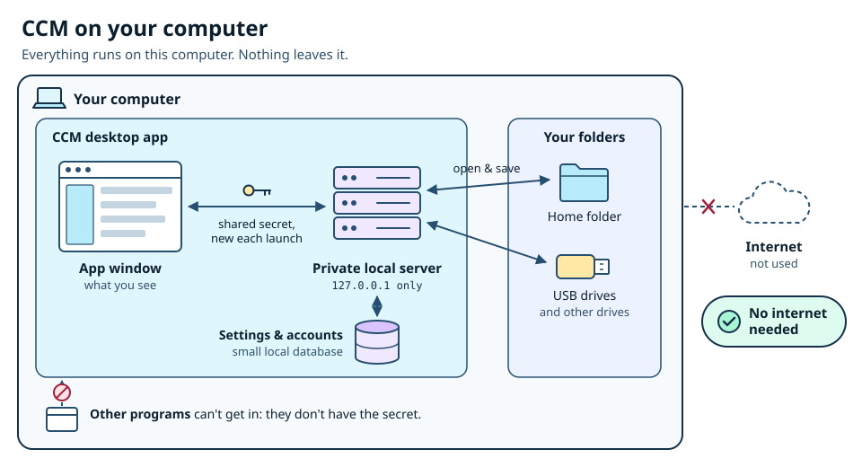

> [!NOTE]
> CCM does not copy your files into a library or a hidden store. A folder you open in CCM is the same folder you see in
> Finder, File Explorer or Files. CCM adds only a few small hidden folders, described in the last chapter.

## Words used in this guide

- **Storage**: a place listed on CCM's **Drives** page. It is a folder on your computer (such as your Home folder) or a
  drive you plug in, such as a USB stick.
- **Memory**: a folder that an AI tool uses as its memory. CCM shows it with a brain icon and its own name.
- **Key file**: a small file (ending in `.ccmkey`) that CCM creates when you encrypt a folder. It works like the only
  key to a safe. You need it to open the folder.
- **Admin**: the person who set up CCM. The admin can add other user accounts and change every setting.

# System requirements

This chapter lists the computers CCM runs on. Check it before you download an installer.

| Your computer | What you need |
|---|---|
| Mac | macOS 12 (Monterey) or newer. Use the `arm64` installer on a Mac with Apple silicon (M1 or newer), and the `x64` installer on an Intel Mac. |
| Windows | Windows 10 or Windows 11, 64-bit (x64). |
| Linux | Ubuntu (22.04 or newer) or Fedora, 64-bit (x64 or arm64). Use the AppImage on any of them, or the `.deb` package on Ubuntu and Debian. |

You also need:

- about **400 MB** of free disk space for the app;
- room for CCM's own data (usually a few megabytes);
- **Git**, only if you want to keep a history of changes (see the chapter on versioning). Everything else works without it.

> [!TIP]
> You don't need an internet connection to install or use CCM. You can copy the installer to the computer on a USB
> stick.

# Installing CCM

This chapter shows how to install CCM on a Mac, on Windows and on Linux. Follow the section for your computer.

## On a Mac

The Mac installer is a `.dmg` file, for example `CCM-0.1.0-arm64.dmg`.

1. Double-click the `.dmg` file. A window opens with the CCM icon and your Applications folder.
2. Drag the **CCM** icon onto the **Applications** folder.
3. Wait for the copy to finish, then eject the CCM disk in Finder (click the eject arrow next to it in the side bar).
4. Open your **Applications** folder and double-click **CCM**.

### If macOS refuses to open CCM

CCM is not signed with an Apple developer certificate. The first time you open it, macOS may say that it can't check
CCM for malicious software, or that CCM "Not Opened". This is expected. You only need to allow it once.

1. Click **Done** (or **OK**) in the message. Don't click **Move to Trash**.
2. Open the Apple menu and choose **System Settings**.
3. Click **Privacy & Security** in the side bar.
4. Scroll down to the **Security** section. You see a line saying that CCM was blocked.
5. Click **Open Anyway**.
6. Enter your Mac password (or use Touch ID) when asked.
7. In the message that appears, click **Open Anyway** again.

CCM now opens, and macOS remembers your choice.

> [!TIP]
> On older versions of macOS you can also right-click **CCM** in Applications, choose **Open**, then click **Open** in
> the message.

> [!NOTE]
> When CCM first opens a folder such as Documents, Desktop or Downloads, or a USB drive, macOS may ask whether CCM may
> access it. Click **Allow**. Otherwise CCM can't show the files in that folder.

## On Windows

The Windows installer is a `.exe` file, for example `CCM-Setup-0.1.0-x64.exe`.

1. Double-click the installer.
2. If Windows shows **Windows protected your PC**, click **More info**, then **Run anyway**. This message appears
   because the installer is not signed with a certificate.
3. Choose whether to install CCM only for you or for everyone who uses the computer, and click **Next**. "Only for me"
   needs no administrator rights.
4. Choose where to install CCM, or keep the suggested folder. Click **Install**.
5. When the installer finishes, click **Finish**.

The installer adds a **CCM** shortcut to your desktop and to the Start menu.

> [!NOTE]
> The SmartScreen message appears only for the installer. Once CCM is installed, it opens normally.

## On Linux

There are two kinds of Linux installer. Choose one:

- the **AppImage** (`CCM-0.1.0-x86_64.AppImage` or `CCM-0.1.0-arm64.AppImage`) runs on Ubuntu, Fedora and most other
  versions of Linux, and needs no installation;
- the **deb package** (a file ending in `.deb`) installs CCM on Ubuntu and Debian, with an entry in the applications
  menu.

### Using the AppImage

1. Copy the AppImage to a folder you keep, for example your Home folder.
2. Open a terminal in that folder.
3. Allow the file to run:

   ```bash
   chmod +x CCM-*.AppImage
   ```

4. Start CCM:

   ```bash
   ./CCM-*.AppImage
   ```

You can also right-click the AppImage in your file manager, open **Properties**, turn on **Allow executing file as
program**, and then double-click it.

> [!TIP]
> If the AppImage doesn't start, your system may be missing the FUSE library that AppImages use. On Ubuntu you can use
> the deb package instead.

### Using the deb package (Ubuntu and Debian)

1. Open a terminal in the folder that holds the `.deb` file.
2. Install it:

   ```bash
   sudo apt install ./CCM-*.deb
   ```

   This works without internet when your computer already has everything CCM needs, which is the case on a normal
   Ubuntu desktop. You can also use:

   ```bash
   sudo dpkg -i CCM-*.deb
   ```

3. Enter your password when asked.
4. Open **CCM** from your applications menu.

# First run: creating the admin account

The first time CCM starts, it asks you to create an account. This chapter walks you through it. The account protects
CCM with a password, so nobody else using your computer can open your files through CCM.

While CCM starts, a small window shows **CCM** and **Starting…**. After a moment the setup page opens.

## Creating the account

1. Read the welcome text and click **Get started**. The badge at the top says **Desktop mode**.
2. Enter an **Admin username**. Use 3 to 32 letters, digits, dots, dashes or underscores. Capital letters don't
   matter: `Alex` and `alex` are the same name.
3. Enter a **Password** of at least 10 characters. It can't be the same as the username. The bar under the field shows
   how strong it is: mixing capital letters, small letters, digits and symbols makes it stronger.
4. Enter the same password again in **Confirm password**, then click **Continue**.

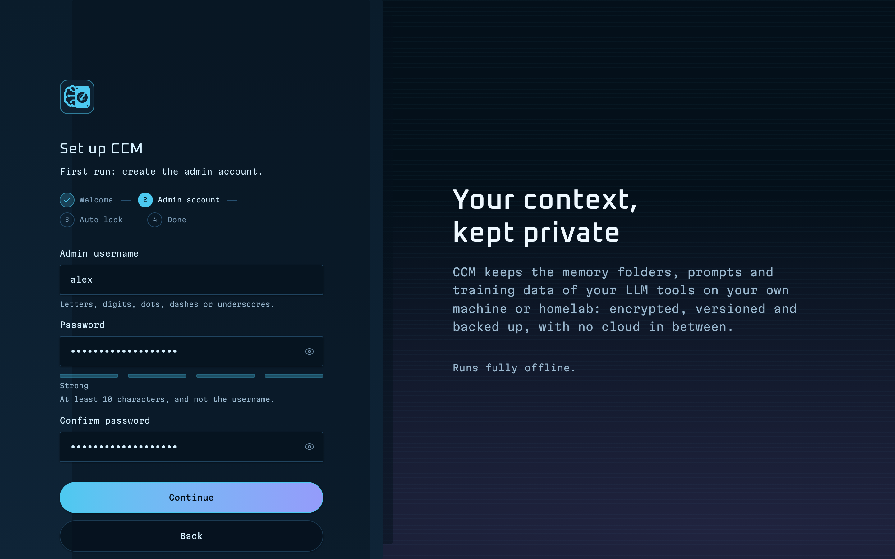

## Finishing setup and signing in

1. Choose after how many idle minutes CCM locks itself (**Lock after this many idle minutes**). The default is 15. You
   can change it later.
2. Click **Create admin**. The page says **CCM is ready.**
3. Click **Go to sign in**.
4. Enter your username and password and click **Sign In**.


> [!WARNING]
> Choose a password you will remember. If you forget it and there is no other admin, the only way back in is to reset
> CCM (see the troubleshooting chapter). Resetting never deletes your files, but you have to set CCM up again.

## Auto-lock

When you don't use CCM for the number of minutes you chose, it locks. The lock screen shows your name and asks for your
password. Type it and click **Unlock** to carry on where you were. Click **Sign out** to leave instead.

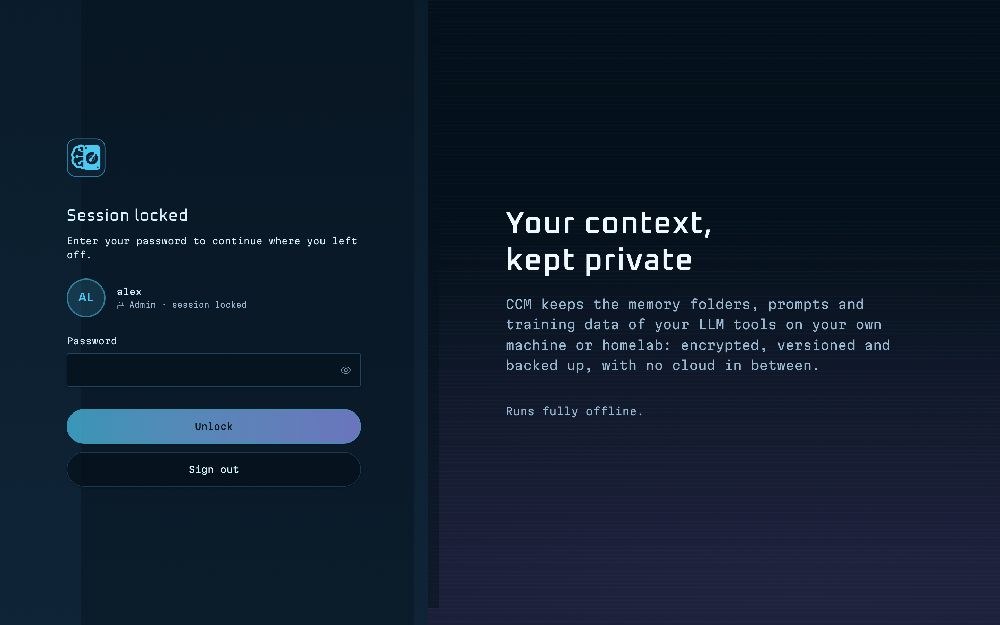

Locking also locks every encrypted folder you had opened (see the encryption chapter). If you have unsaved changes when
the lock is near, CCM warns you 30 seconds before, so you can save.

You can lock CCM yourself at any time: click your initials at the top right and choose **Lock now**.

# A tour of CCM

This chapter shows the parts of the CCM window and what each one is for.

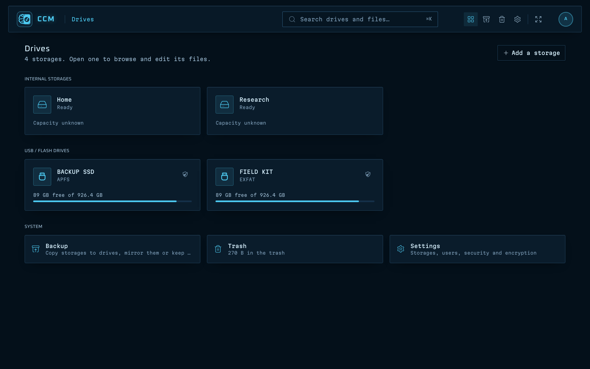

## The Drives page

After you sign in, CCM opens the **Drives** page. It shows each of your **storages** as a card, in groups:

- **Internal storages**: folders on your computer. CCM adds your **Home** folder for you. You can add more in
  **Settings › Storages**.
- **External drives**: external hard drives you plug in.
- **USB / flash drives**: USB sticks and memory cards.

Click a card to open that storage. A drive appears a few seconds after you plug it in, and is highlighted briefly. Each
card shows how much space is free, for example "2.8 GB free of 3 GB". Drives you can unplug have an eject button. Click
it and confirm with **Eject**. When CCM says the drive was ejected, you can unplug it.

> [!TIP]
> When you have many drives, type part of a name in **Filter drives…** at the top of the page to show only those.

> [!NOTE]
> On Linux, a drive that isn't mounted yet shows **Mount**. Click it to make its files available.

Under **System** you find **Backup**, for copying folders to drives, **Trash**, with the total size of deleted items,
and **Settings**.

## The top bar

The bar at the top of every page holds, from left to right:

- the **CCM** logo, a brain wired into a hard drive. Click it to go back to the Drives page;
- a line that shows where you are, for example "Drives › Home › Notes › today.md". Click any part to go there;
- **Search drives and files…**. See *Quick search* below;
- buttons for the **Drives** page, **Backup**, **Trash** and **Settings**;
- a **progress ring** while something runs in the background, such as a large copy, a backup or an encryption. Click
  it to see every running task;
- a **key button** while encrypted folders are open. Click it to see which ones and when they lock again;
- a **full screen** button;
- your **initials**. Click them for **Settings**, **Lock now**, **Lock all encrypted folders** and **Sign out**.

## Quick search

Click **Search drives and files…** in the top bar, or press <kbd>Cmd</kbd>+<kbd>K</kbd> on a Mac
(<kbd>Ctrl</kbd>+<kbd>K</kbd> on Windows and Linux), to open quick search. Without typing anything it lists your drives
and the pages of CCM. Type part of a name to find:

- a **drive**, to switch to it;
- a **file or folder** in the storage that is open, by its name;
- **Backup**, **Trash** or **Settings**.

Use the arrow keys to pick a result and press <kbd>Enter</kbd> to open it, or click it.

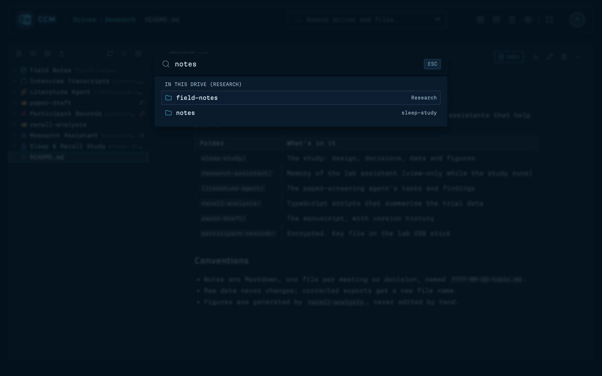

## The explorer

When you click a storage, the explorer opens. It has two panes:

- on the left, the **file tree**: the folders and files of the storage. Click the arrow next to a folder to open it.
  The toolbar above the tree has **New file**, **New folder**, **New memory**, **Upload files**, **Refresh**,
  **Collapse all** and **Hide file tree**;
- on the right, the **file pane**: what you selected.


Drag the line between the two panes to make one wider. To give the file pane the whole width, click **Hide file tree**,
drag the line all the way to the left, or press <kbd>Cmd</kbd>+<kbd>\</kbd> (<kbd>Ctrl</kbd>+<kbd>\</kbd> on Windows
and Linux). A slim bar with a **Show file tree** button stays on the left; click it, or press the same keys, to bring the
tree back.

When you select a **folder**, the file pane shows an overview: how many files it holds, their total size, when it last
changed, and buttons for common tasks. When you select a **file**, the pane shows its contents.

Small badges in the tree show a folder's state: a lock or an eye for protection, a key for encryption, and the brain
icon for a memory.

## Viewing and editing files

CCM always opens a file in **view mode** first, so you can't change it by accident. To change a text file, click
**Edit** at the top of the file pane. To go back, click **View**.

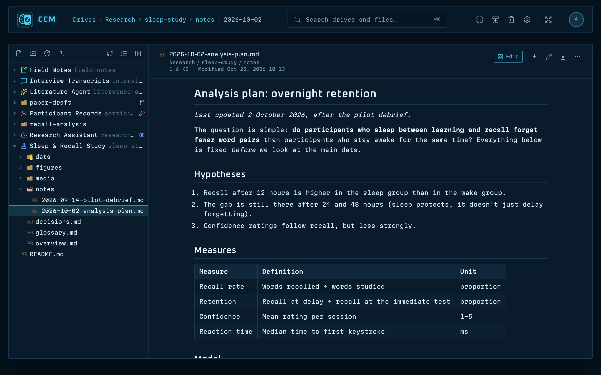

What CCM shows depends on the kind of file:

| Kind of file | What you see |
|---|---|
| Markdown (`.md`) | The formatted note, with headings, lists, tables and links. Click **Edit** for the Markdown editor. |
| Code and text | The text with colours for the language. Click **Edit** for the code editor. |
| Images | The picture, with **Fit to window**, **Actual size**, **Zoom in** and **Zoom out**. |
| CSV and TSV tables | A table you can sort, search (**Search all columns**) and filter per column. |
| PDF | The pages, with **Fit to width** and zoom. PDFs can't be edited. |
| Video and audio | The file's details only. CCM does not play media files. |
| Other files | The file's details and a **Download** button. |

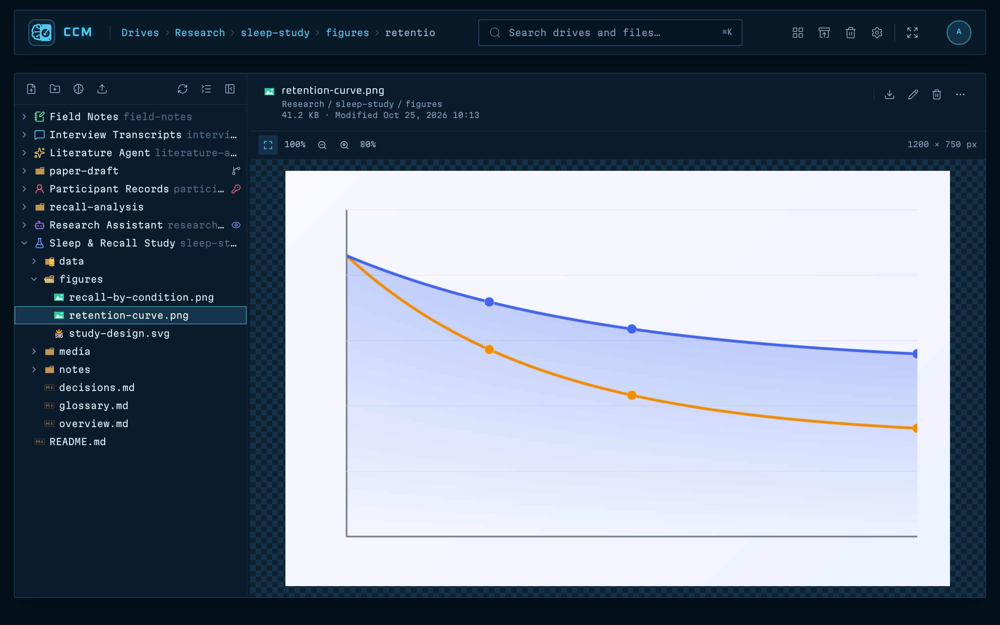

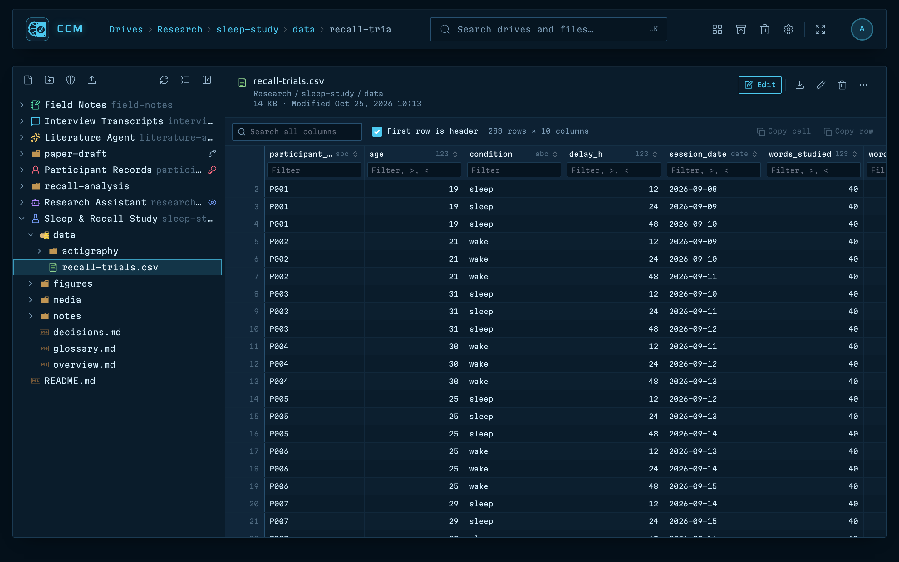

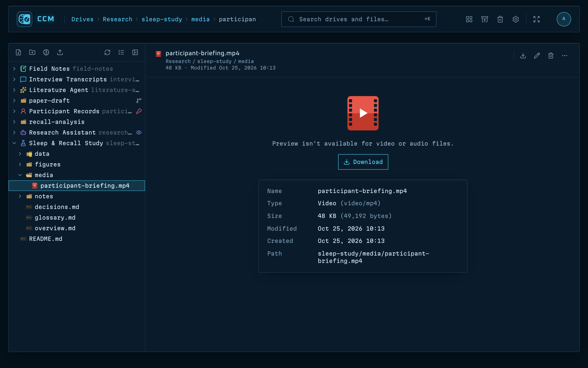

> [!NOTE]
> Pictures that a Markdown note loads from the internet are not shown. CCM displays "External image blocked
> (offline/privacy)" instead. Links to websites ask **Open … in your browser?** before they open, because your browser
> may use the internet.

### The Markdown editor

The Markdown editor shows the formatting as you type, like a word processor. Its toolbar has buttons for paragraphs and
headings, bold, italic, lists, task lists, quotes, code, tables and links. Hover over a button to see its keyboard
shortcut.

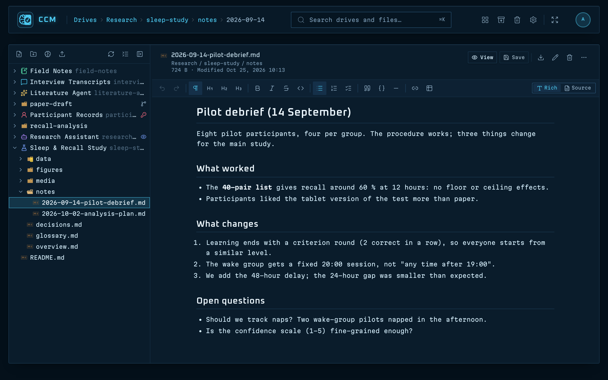

On the right of the toolbar you can switch between **Rich** (formatted) and **Source** (the plain Markdown text). Some
notes open in Source mode by themselves, when the rich editor could change how they are written.

### The code editor

Code and text files open in the code editor. It shows the language at the top, for example "Python" or "Plain text",
and has a button to turn word wrap on and off.

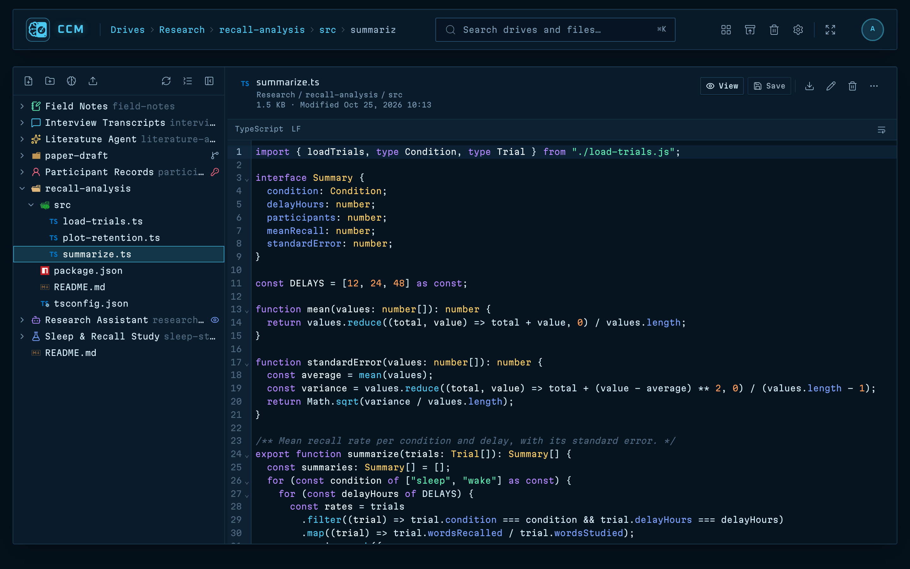

### Saving

1. Click **Save** at the top of the file pane, or press <kbd>Cmd</kbd>+<kbd>S</kbd> on a Mac or <kbd>Ctrl</kbd>+<kbd>S</kbd>
   on Windows and Linux.
2. The button shows **Saving…** while it works. A small yellow dot on the **Save** button means there are unsaved
   changes.

If you try to open another file or leave edit mode with unsaved changes, CCM asks **Save changes to "…"?**. Choose
**Save**, **Discard** (throw the changes away) or **Cancel** (stay where you are).

> [!TIP]
> Very large text files (over 5 MB by default) open in view mode only, because editing them would be slow. An admin can
> change this limit in **Settings › General › Viewer and editor**.

### When a file changes outside CCM

If another program, for example an AI tool, changes the file you have open, a yellow bar says **This file changed on
disk.** Choose:

- **Reload** to see the new version;
- **Keep mine** to carry on with what you have;
- **Compare** to see both versions side by side.

If the file was deleted or moved instead, the bar says **File was removed or moved.** Click **Save as…** to keep your
version under a new name, or **Close**.

If you save while the file has changed on disk, CCM says the file **changed on disk** and lets you choose:

- **Reload from disk**: take the other version and lose your changes;
- **Overwrite**: keep your version and replace the other one;
- **Compare**: see both versions side by side. The version on disk is on the left and yours on the right. Copy the
  parts you want into yours, then click **Save this version**.

# Working with files

This chapter covers everyday tasks: creating, renaming, moving, copying, uploading and downloading. Most of them are
in the right-click menu of the file tree.

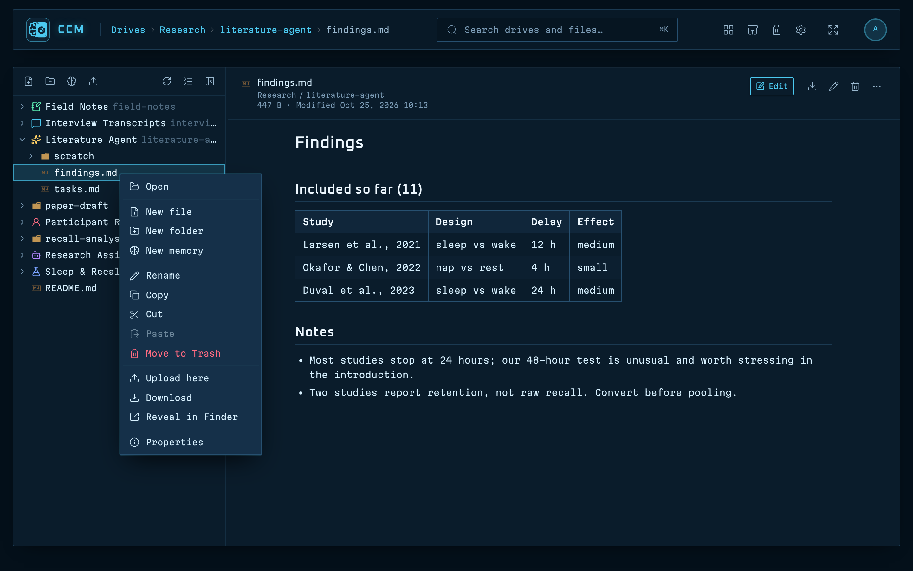

## Creating files and folders

1. In the tree, right-click the folder where the new item should go.
2. Choose **New file** or **New folder**.
3. Type the name in the box that appears in the tree and press <kbd>Enter</kbd>. Press <kbd>Esc</kbd> to cancel.

You can also use **New file** and **New folder** in the toolbar above the tree. They create the item in the folder you
selected.

> [!NOTE]
> A few characters and names can't be used, because some computers don't allow them. CCM tells you right away when a name
> is not allowed.

## Renaming

1. Select the file or folder in the tree.
2. Press <kbd>F2</kbd>, or right-click it and choose **Rename**.
3. Type the new name and press <kbd>Enter</kbd>.

You can also click **Rename** at the top of the file pane. It opens a small window where you type the **New name**.

## Moving and copying

**With the mouse:**

- Drag a file or folder onto another folder in the tree to **move** it there.
- Hold <kbd>Option</kbd> (Mac) or <kbd>Alt</kbd> (Windows and Linux) while you drag to **copy** it instead.

**With the menu or the keyboard:**

1. Right-click the item and choose **Copy** or **Cut**, or press <kbd>Ctrl</kbd>+<kbd>C</kbd> or
   <kbd>Ctrl</kbd>+<kbd>X</kbd> (<kbd>Cmd</kbd> on a Mac).
2. Right-click the folder where it should go and choose **Paste**, or select the folder and press
   <kbd>Ctrl</kbd>+<kbd>V</kbd> (<kbd>Cmd</kbd>+<kbd>V</kbd> on a Mac). The folder can be on another storage, such as a
   USB stick: switch to it with quick search first.

If an item with the same name is already there, a copy gets a new name such as "notes (copy).md". A move stops and tells
you the name is taken.

Large copies run in the background. The progress ring in the top bar shows how far they are, and you can keep working.

> [!TIP]
> To select several items, hold <kbd>Cmd</kbd> (Mac) or <kbd>Ctrl</kbd> (Windows and Linux) and click each one. Hold
> <kbd>Shift</kbd> and use the arrow keys to select a range. <kbd>Ctrl</kbd>+<kbd>A</kbd> (<kbd>Cmd</kbd>+<kbd>A</kbd>)
> selects everything in view.

## Uploading files

"Uploading" means copying files from anywhere on your computer into a folder in CCM.

1. Drag files from Finder, File Explorer or your file manager onto a folder in the tree, or onto the file pane. The pane
   shows **Drop to upload to …**.
2. Let go of the mouse button.

Or:

1. Right-click a folder and choose **Upload here**, or click **Upload files** in the toolbar.
2. Choose the files and confirm.

A panel at the bottom of the window shows each file's progress. CCM uploads three files at a time. You can keep
browsing while it works.

If a file with the same name already exists, CCM asks what to do: **Replace** it, **Keep both** (the new file is saved
as "name (1).ext"), or **Skip** it. Tick **Do this for every name clash in this upload** to answer once for all files.

> [!NOTE]
> You can drop files, but not whole folders, from your computer. CCM skips folders and tells you so. Drop the files
> inside the folder instead.

## Downloading files

"Downloading" means saving a copy of a file from CCM somewhere else on your computer.

1. Select the file and click **Download** at the top of the file pane, or right-click it and choose **Download**.
2. Choose where to save the copy.

For a folder, choose **Download as zip**. CCM puts the whole folder into one `.zip` file.

> [!NOTE]
> The desktop app never asks for your password before an upload or a download. (CCM's server edition, used on a shared
> network, can ask for it.)

## Other useful commands

- **Reveal in Finder** (Mac), **Reveal in Explorer** (Windows) or **Reveal in Files** (Linux) opens your computer's own
  file manager at that file.
- **Copy path**, in the **⋯** menu at the top of the file pane, copies the file's location inside its storage.
- **Properties** shows a file's name, kind, size, location, when it was created and changed, and its status.

### Keyboard shortcuts in the file tree

| Keys | What they do |
|---|---|
| <kbd>↑</kbd> <kbd>↓</kbd> | Move up and down the list |
| <kbd>→</kbd> <kbd>←</kbd> | Open or close a folder |
| <kbd>Enter</kbd> | Open the selected item |
| <kbd>F2</kbd> | Rename |
| <kbd>Delete</kbd>, or <kbd>Cmd</kbd>+<kbd>Backspace</kbd> on a Mac | Move to Trash |
| <kbd>Ctrl</kbd>/<kbd>Cmd</kbd>+<kbd>C</kbd>, <kbd>X</kbd>, <kbd>V</kbd> | Copy, cut, paste |
| <kbd>Ctrl</kbd>/<kbd>Cmd</kbd>+<kbd>,</kbd> | Open the settings of the selected folder |
| Typing letters | Jump to the first item whose name starts with them |

# Trash

When you delete something in CCM, it goes to CCM's Trash first. This chapter explains how to get it back, or get rid
of it for good.

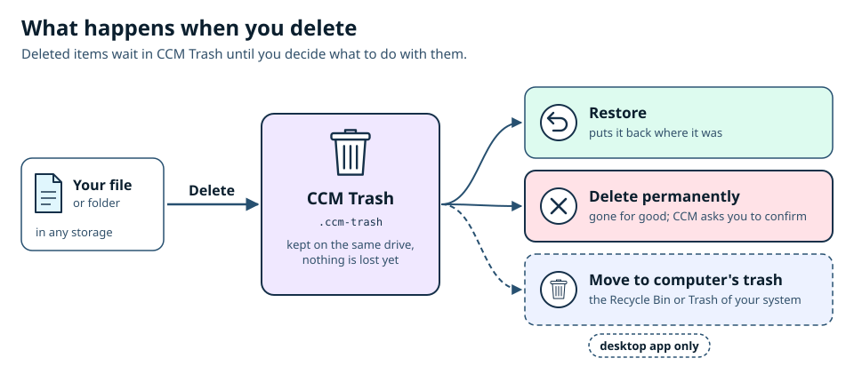

## Moving items to the Trash

1. Select one or more items in the tree.
2. Right-click and choose **Move to Trash**, or press <kbd>Delete</kbd>.
3. Confirm with **Move to Trash**.

Each storage keeps its own Trash. Something you delete from a USB stick stays on that stick, in its Trash, until you
empty it. That way, moving to the Trash is instant, even for large folders.

## The Trash page

Click **Trash** in the top bar or on the Drives page. The page lists every deleted item with its **Name**, **Original location**, when it
was **Deleted**, who deleted it (**Deleted by**) and its **Size**. Use the storage list and **Search by name** to find
an item.

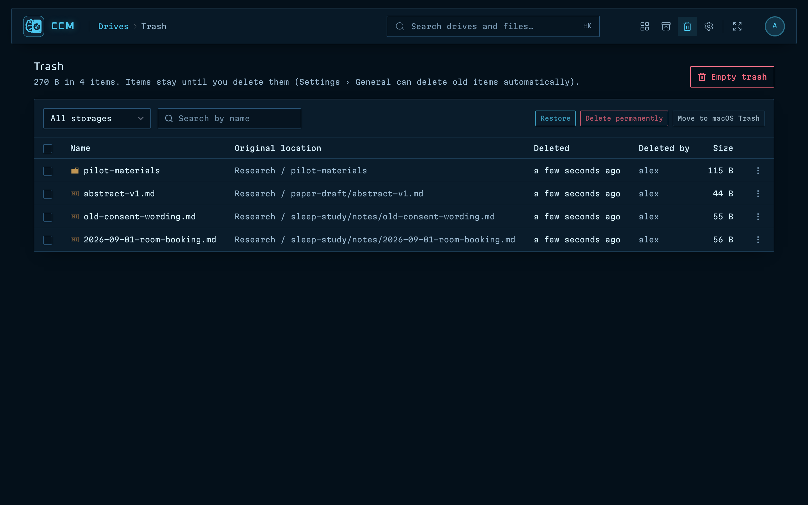

## Restoring an item

1. Click the **⋮** button at the end of the item's row.
2. Choose **Restore**.

The item goes back to where it was. If that folder no longer exists, CCM creates it again. If something else now has the
same name, the restored item is called "name (restored)".

To restore several items at once, tick them and click **Restore** above the list.

## Deleting permanently

1. Click **⋮** on the item's row and choose **Delete permanently**, or tick several items and click
   **Delete permanently** above the list.
2. Confirm with **Delete permanently**.

> [!WARNING]
> Items you delete permanently are removed from the disk for good. This can't be undone.

## Moving items to your computer's trash

You can hand items over to your computer's own trash instead. They then sit in the Mac's Trash or the Windows Recycle
Bin with your other deleted files.

1. Click **⋮** on the item's row.
2. Choose **Move to macOS Trash** (Mac), **Move to Recycle Bin** (Windows) or **Move to computer trash** (Linux).

## Emptying the Trash

1. Click **Empty trash** at the top right of the Trash page.
2. Under **Which trash**, choose **All storages** or a single storage.
3. Type `EMPTY` to confirm, then click **Empty trash**.

> [!TIP]
> CCM can delete old items for you. An admin can set **Settings › General › Trash › Delete items after** to a number of
> days. The default, 0, keeps items until you delete them.

# Memory folders and templates

A memory is a folder that an AI tool uses to remember things between conversations. This chapter shows how to create
one, and what the templates put inside.

To your AI tools, a memory is a normal folder with normal files. CCM simply gives it a name, an icon and a colour, and
an overview page that shows what it holds.

## Creating a memory

1. Right-click the folder where the memory should go and choose **New memory**. You can also click **New memory** in the
   toolbar above the tree.
2. Enter a **Name**, for example "Claude persona".
3. CCM suggests a **Folder name** made from the name. Change it if you like.
4. Add a **Description**: what the memory holds and which tools use it.
5. Choose an **Icon** and a **Colour**.
6. Choose a **Template** (see below).
7. Click **Create memory**.

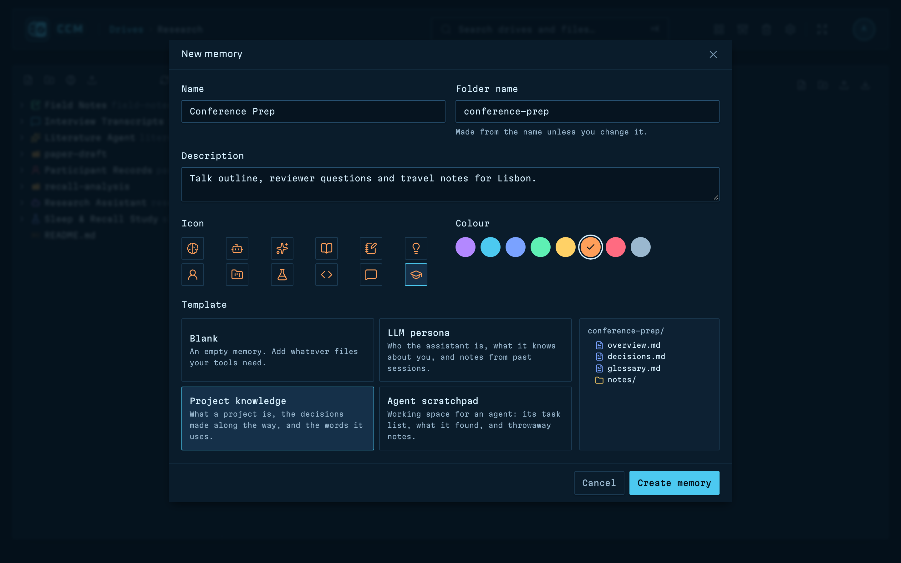

## The templates

A template gives a new memory a few starter files. Each file begins with a short tip on what to write in it.

| Template | What it is for | Files it creates |
|---|---|---|
| **Blank** | An empty memory. Add whatever files your tools need. | None |
| **LLM persona** | Who the assistant is, what it knows about you, and notes from past sessions. | `identity.md`, `facts.md`, `preferences.md` and a `sessions` folder |
| **Project knowledge** | What a project is, the decisions made along the way, and the words it uses. | `overview.md`, `decisions.md`, `glossary.md` and a `notes` folder |
| **Agent scratchpad** | Working space for an agent: its task list, what it found, and throwaway notes. | `tasks.md`, `findings.md` and a `scratch` folder |

## The memory overview

Click a memory in the tree to see its overview: its name and description, the number of files and notes, the total
size, when it last changed, whether it keeps a history, and its most recent files.

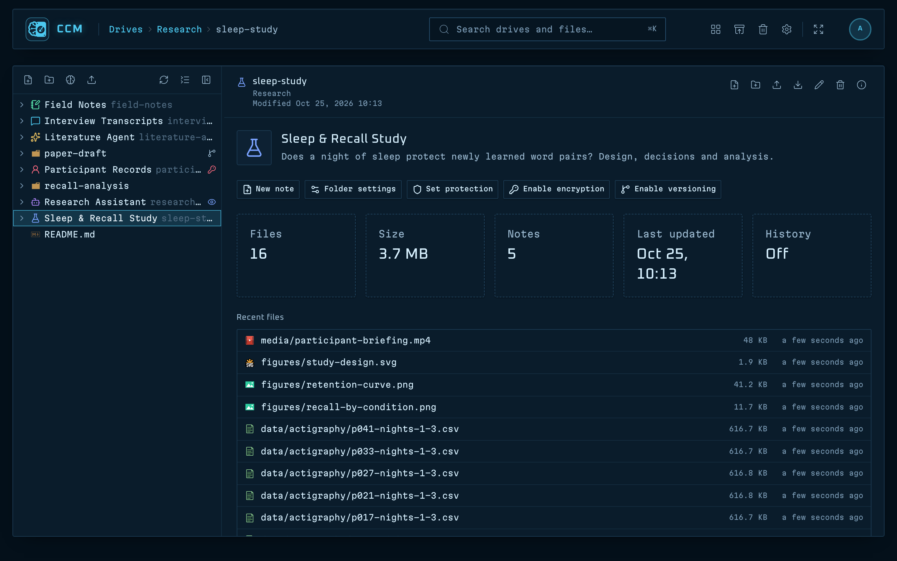

Click the description to change it. Press <kbd>Enter</kbd> to save it.

The buttons under the description give quick access to common tasks: **New note**, **Folder settings**, **Set
protection**, **Enable encryption** and **Enable versioning** (or **History** once versioning is on).

## Turning an existing folder into a memory

1. Right-click the folder and choose **Convert to memory**.
2. Fill in the name, description, icon and colour.
3. Click **Convert**.

The files inside stay exactly as they were. To turn a memory back into a plain folder, right-click it and choose
**Convert to plain folder**. Again, the files are not touched.

## Changing a memory's name, icon or colour

1. Right-click the memory and choose **Folder settings**.
2. On the **General** tab, change the name, description, icon or colour.
3. Click **Save**.

> [!NOTE]
> A memory's settings are stored inside the memory, in a hidden `.ccm` folder. So a memory stays a memory when you copy it
> to a USB stick or back it up.

# Protecting folders from changes

AI agents and other programs can change or delete files by mistake. Protection stops that. This chapter explains the
two levels of protection and what they can and can't stop.

## The two levels

| Level | What it means |
|---|---|
| **None** | Anyone with write access can change and delete it. |
| **View-only** | It can be opened, copied and downloaded, but not changed, renamed, moved or deleted. Editors can turn this off. |
| **Locked** | Like view-only, and only an admin who confirms their password can unlock it. Use it for memories agents must never touch. |

Protection covers everything inside a folder. If a folder sits inside a protected folder, the stricter of the two
settings applies.

## Protecting a folder

1. Right-click the folder and choose **Protection…**. You can also click **Set protection** on the folder's overview.
2. The **Protection** tab of the folder settings opens. Choose **View-only** or **Locked**.
3. Read the yellow note: it tells you what CCM changes on your disk.
4. Click **Apply**.

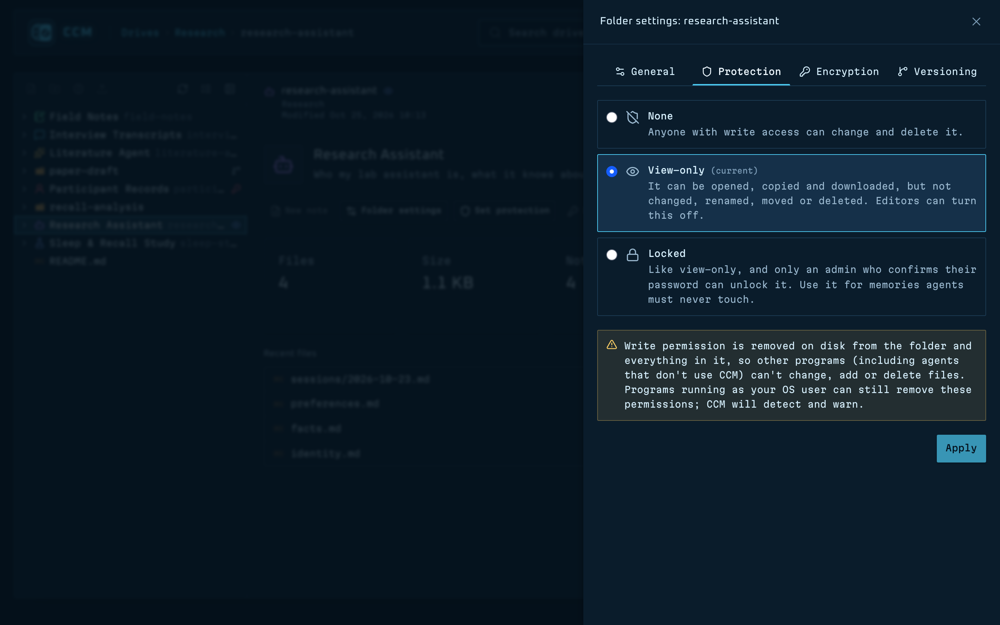

For a large folder, a progress bar shows how many items are done. A lock or eye badge then appears next to the folder in
the tree.

To protect a single file, right-click it, choose **Properties**, and open **Protect this file**.

## Removing protection

1. Open the **Protection** tab again.
2. Choose **None** (or **View-only** to step down from Locked).
3. To unlock a **Locked** folder, enter **Your password**. Only an admin can do this.
4. Click **Apply**.

CCM puts every file's original permissions back.

## What protection can and can't stop

CCM protects a folder in two ways at once:

- **Inside CCM**, nobody can change a protected item. Buttons such as **Edit**, **Rename** and **Move to Trash** are
  greyed out, with the reason.
- **On the disk**, CCM removes the "write" permission from the folder and everything in it. This is the same permission
  your computer uses for every file. So programs that don't use CCM, including AI agents that write files directly, are
  stopped too.

Here is what that means for an AI agent working on your computer:

| An agent… | View-only or Locked |
|---|---|
| reads the files | Allowed. Protection never hides files. |
| copies the files somewhere else | Allowed. |
| changes, renames or deletes a file | Refused by your computer. |
| adds a new file to the folder (Mac and Linux) | Refused by your computer. |
| runs as an administrator, with `sudo` or as root | **Not stopped.** An administrator can ignore permissions. |
| changes the permissions back first, then edits | Possible, because the agent runs as you. CCM notices, warns you, and makes the file read-only again. |

> [!WARNING]
> Protection is a strong safety net, not a wall. It stops tools that respect your computer's permissions. It does not stop
> a program running as an administrator or root, or a program that deliberately changes permissions. Don't give AI
> agents administrator rights if they work near protected folders.

When a program changes something in a protected folder, CCM shows a message, and a red banner on the folder's overview
says **An external process modified a protected folder**, with what changed and when. CCM has already made the file
read-only again. Click **Dismiss** to hide the banner. CCM can only notice this while it is running.

### On Windows

Windows can mark files read-only, but not folders. So in a protected folder, Windows stops programs from changing files,
but can't stop them adding new files. CCM refuses such files inside the app and warns you when another program adds one.

### Strong lock on a Mac

On a Mac, an admin can turn on **Settings › General › Strong lock (macOS)**. Locked folders then also get the macOS
"immutable" flag, an extra barrier on top of the permissions. A program then has to remove that flag as well before it
can change anything. It applies to folders you lock after turning it on.

# Encryption: key file and password

Encryption turns the files in a folder into unreadable data on your disk. Only someone with the folder's key file and a
CCM account can read them. This chapter explains how it works, how to set it up, and how to keep your key file safe.

## How it works

When you encrypt a folder, CCM creates a new, random key for it and gives it to you as a **key file** (a small file whose
name ends in `.ccmkey`). CCM does not keep a copy. Every file in the folder is then encrypted on the disk.

To read or edit the files, you **unlock** the folder with two things:

- the **key file**, which is the actual key;
- your **CCM password**, which confirms that it is really you.

While the folder is unlocked, CCM decrypts files in memory to show them, and encrypts them again when you save. The
readable version is never written to the disk. When the folder locks again, CCM forgets the key.


What is **not** encrypted: file and folder names, the folder structure, roughly how big each file is, and a memory's name
and description. Don't put secrets in file names.

## Keep your key file safe

> [!DANGER]
> **The key file is the only key.** CCM never stores it. If you lose it, the files in the folder can't be recovered: not
> by you, not by an admin, not by anyone else. Your password can't replace it, and resetting CCM doesn't bring it back.

Before you encrypt anything, decide where the key file will live:

- **Copy it to a USB drive you keep somewhere else**, or store it in your password manager. Two copies in two places
  are better than one.
- **Keep it outside the encrypted folder.** You can't open the folder to get its own key.
- **Keep it private.** Anyone with the key file and a CCM account that can see the folder can read it.
- **Each folder has its own key file.** Label them clearly if you encrypt several folders.

> [!WARNING]
> Backups of an encrypted folder are encrypted too. A backup does not help if you have lost the key file. Keep the key
> file apart from your backups as well.

## Encrypting a folder

1. Right-click the folder and choose **Folder settings**, then open the **Encryption** tab. Or click
   **Enable encryption** on the folder's overview.
2. Click **Encrypt this folder…**. The **Encrypt "…"** wizard opens. It has five steps.

### Step 1: Understand

Read the explanation. Tick **I understand: without the key file, the data can't be recovered.** Click **Next**.

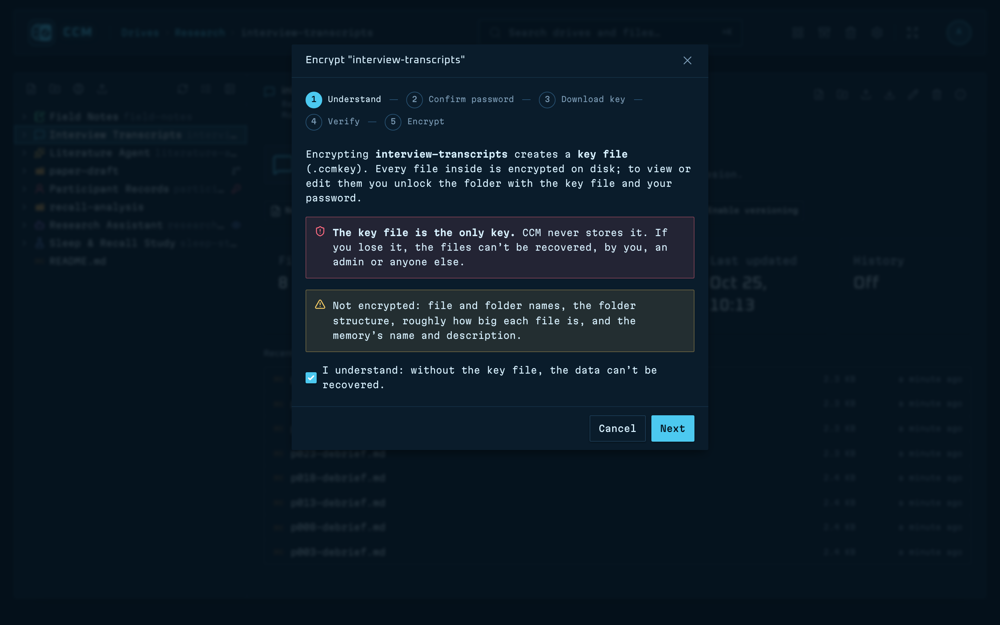

### Step 2: Confirm password

Enter **Your password** (your CCM password) and click **Next**.

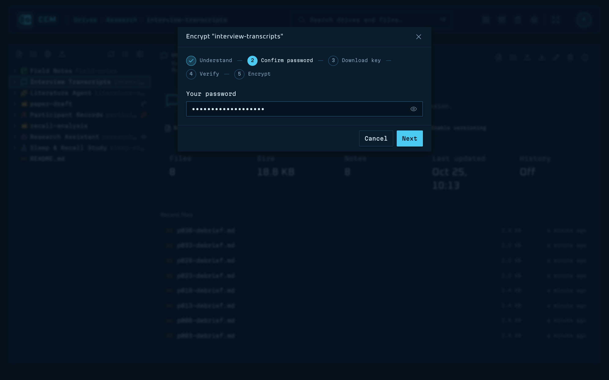

### Step 3: Download key

1. Click **Download key file**.
2. Save the file somewhere safe, ideally straight onto a USB drive you keep apart. The file is named after the folder,
   for example `persona.ccmkey`.
3. Click **Next**.

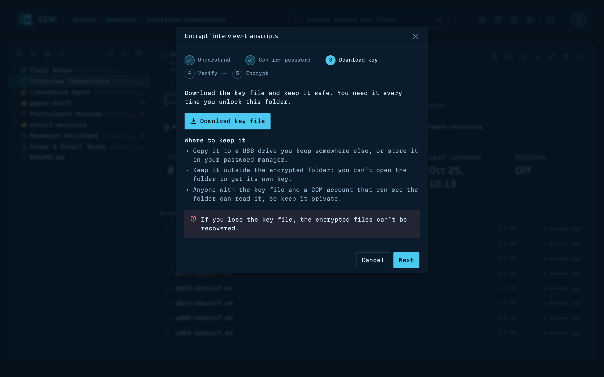

### Step 4: Verify

CCM checks that you really saved the key file.

1. Drop the `.ccmkey` file you just saved into the box, or click **Choose file** and pick it.
2. CCM says **That's the right key file.** Click **Next**.

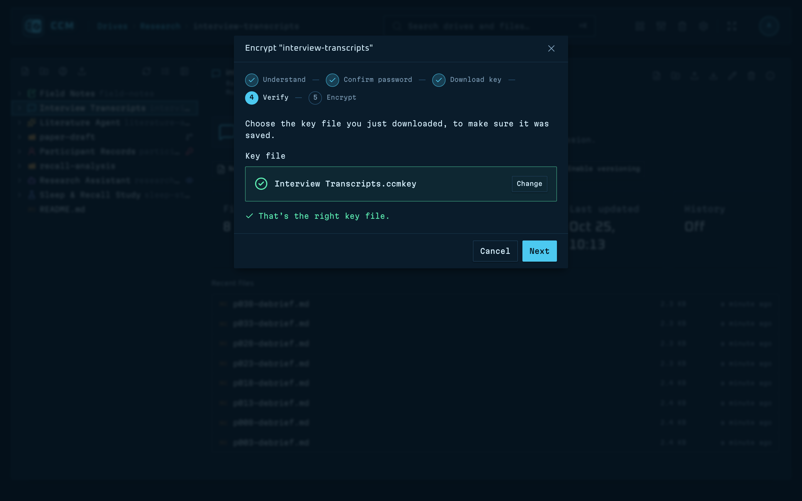

### Step 5: Encrypt

1. Click **Encrypt now**.
2. A progress bar shows the files, the amount done, the speed and the time left.
3. When it finishes, CCM says the folder **is encrypted and unlocked for this session**. Click **Done**.

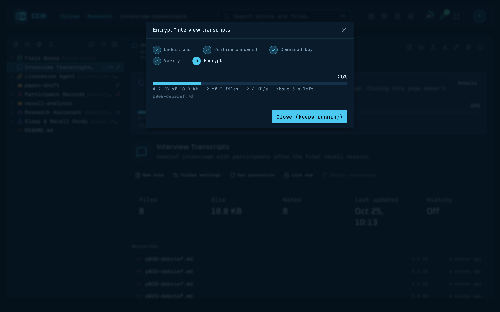

Large folders take a while. You can click **Close (keeps running)** and carry on working. The progress ring in the top
bar shows how far it is, and a message tells you when it has finished.

> [!NOTE]
> A folder that keeps a history (versioning) can't be encrypted. Turn versioning off first. An encrypted folder can't
> be put inside another encrypted folder either.

## Unlocking an encrypted folder

An encrypted folder shows a red key in the tree. When you click it, or a file inside it, CCM shows an unlock panel.

1. Drop the folder's `.ccmkey` file into the **Key file** box, or click **Choose file**.
2. Enter **Your password**.
3. Click **Unlock**.

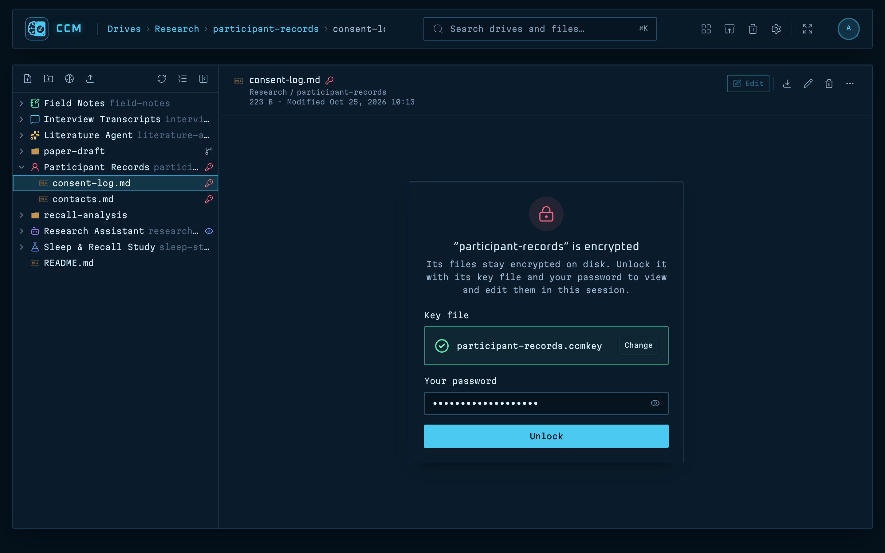

The key in the tree turns green, and the files open as usual. The file pane says **Encrypted · edits are re-encrypted on
save**. When you save, the button shows **Encrypting & saving…**, then **Verifying…**, while CCM checks the new
encrypted file before it replaces the old one.

## How long a folder stays unlocked

A folder locks again by itself when:

- the unlock time runs out (60 minutes by default; an admin can change it in **Settings › Encryption › Unlock time**);
- CCM locks after you have been idle, or you choose **Lock now**;
- you sign out or quit CCM.

Click the key button in the top bar to see which folders are unlocked and when each one locks.

## Locking folders yourself

- To lock one folder: open its overview and click **Lock now**, or click **Lock now** on its **Encryption** tab.
- To lock every folder at once, use **Lock all encrypted folders**: in the key button's menu in the top bar, or in the
  menu under your initials. **Settings › Encryption** has a **Lock all** button too.

CCM wipes the keys from its memory straight away.

## Copying and downloading encrypted files

- When you **download** a file from an encrypted folder, CCM asks how: **Decrypted** (the readable file; the folder must
  be unlocked) or **Encrypted (raw)** (the file as stored, still encrypted, which only CCM with the key file can open).
  Folders downloaded as zip are always decrypted.
- When you **copy or move** a file out of an encrypted folder into a normal one, CCM asks **Copy out of the encrypted
  folder?** (or **Move out of…**). If you confirm with **Copy and decrypt**, the copy is readable by anyone who can
  read that folder.
- Moving a whole encrypted folder to another place keeps it encrypted.

If another program writes files into an encrypted folder, those files are not encrypted. The **Encryption** tab then
says how many there are. Unlock the folder and click **Encrypt … files now**.

## Using an encrypted folder on another computer

An encrypted folder carries its encryption settings with it. Copy the folder to another computer that runs CCM, for
example with a USB stick. Then unlock it there with the same key file and your password on that computer. The password
only confirms who you are. It is not part of the key.

## Decrypting a folder permanently

Decrypting turns every file back into a normal, readable file and ends encryption for the folder.

1. Open the folder's **Folder settings › Encryption**.
2. In the **Danger zone**, click **Decrypt permanently…**.
3. Add the key file, enter **Your password**, and type the folder's name to confirm.
4. Click **Decrypt permanently**.

The work runs in the background. The folder's overview shows **Decrypting in the background** with the progress, and
nothing inside the folder can be changed until it ends. A message says **Decryption finished** when it is done.

> [!WARNING]
> After decrypting, anyone who can read your disk can read the files.

## Re-keying: replacing a key file

Re-key a folder when you think someone else may have a copy of its key file. CCM creates a new key and encrypts every
file again. The old key file stops working.

1. Open **Folder settings › Encryption** and click **Re-key…**.
2. Follow the five steps of the **Re-key "…"** wizard: **Understand**, **Old key** (add the current key file and enter
   your password), **Download new key**, **Verify** and **Re-key**.
3. Click **Re-key now**.

Keep the new key file as carefully as the first one, and destroy the old one once the re-key has finished.

## If an encryption task stops

If CCM is closed or your computer turns off while it encrypts, decrypts or re-keys, nothing is lost. CCM never encrypts
a file twice. To carry on:

1. Open the folder's **Folder settings › Encryption**.
2. Add the key file (both key files for a re-key) and enter your password.
3. Click **Resume encryption** (or **Resume decryption**, **Resume re-keying**).

# Versioning with Git

Versioning keeps a history of every change in a folder, so you can see what changed and undo mistakes. This chapter
explains how to install Git, turn versioning on, and use history, undo and redo.

## Installing Git

CCM keeps the history with **Git**, a free tool that records versions of files. Git must be installed on your computer.
CCM never downloads anything by itself, so you install Git yourself. You need version 2.30 or newer.

### Mac

**With internet:** open Terminal, run `xcode-select --install` and click **Install**. Apple's Command Line Tools
include Git.

**Without internet:** on a computer that has internet, download the Git installer for macOS
(`git-<version>-intel-universal.pkg`) from the official Git website. Copy it over on a USB stick and double-click it.

### Windows

On a computer that has internet, download **Git for Windows** (`Git-<version>-64-bit.exe`) from the official Git for
Windows website. Copy it over on a USB stick, run it and keep the default options.

### Ubuntu and Debian

**With internet:**

```bash
sudo apt install git
```

**Without internet:** on a computer with the **same Ubuntu version and architecture** that has internet, download the
packages without installing them:

```bash
apt download git git-man liberror-perl
```

Copy the `.deb` files over on a USB stick, then install them:

```bash
sudo dpkg -i git_*.deb git-man_*.deb liberror-perl_*.deb
```

If `dpkg` reports a missing package, download that package the same way and include it.

### Fedora

With internet, run `sudo dnf install git`.

> [!TIP]
> To check that Git is installed, run `git --version` in a terminal. It prints something like `git version 2.43.0`.

## Turning versioning on

1. Right-click the folder and choose **Folder settings**, then open the **Versioning** tab and click
   **Enable versioning…**. Or click **Enable versioning** on the folder's overview.
2. The **Turn on versioning** window shows whether Git was found, and its version.
3. If it says **Git not found**, install Git (see above), then click **Check again**. The window also contains the
   install steps.
4. Click **Enable versioning**.

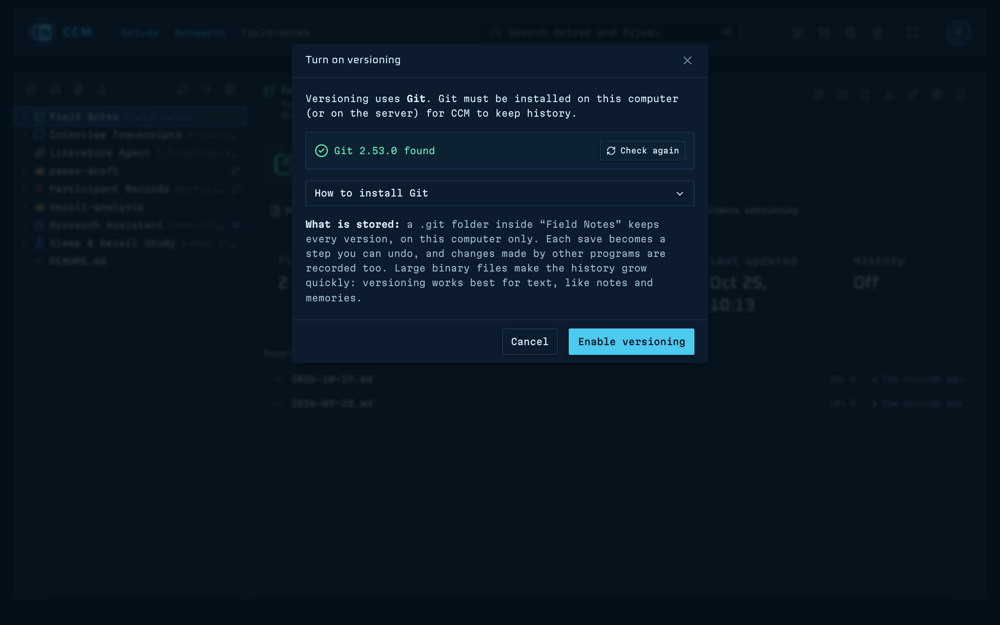

CCM stores the history in a hidden `.git` folder inside the folder, on this computer only. Versioning works best for
text, such as notes and memories. Large pictures or videos make the history grow quickly.

> [!NOTE]
> If the folder already has its own Git history, CCM offers **Keep its history and enable**. It adds its own versions on
> top and changes nothing in the existing history. If the folder had versioning in CCM before, you can choose
> **Restore archived history** or **Start a new history**.

> [!WARNING]
> **Encrypted folders are never versioned.** A history would keep readable copies of your files next to the encrypted
> ones. To version a folder that is encrypted, decrypt it first. To encrypt a versioned folder, turn versioning off first.

## What gets recorded

From now on, every change becomes a **version**:

- each save, upload, new file, rename, move or deletion you make in CCM. The version has a clear name, such as
  "Edit notes.md", "Upload 3 files" or "Moved draft.md to Trash";
- changes made by other programs, such as an AI agent. CCM waits until the folder has been quiet for about ten seconds,
  then records them as "External changes (2 files)". The history marks them as **Changed outside CCM**.

## Undo and redo

The **Undo** and **Redo** buttons appear at the top of the file pane, and on the **Versioning** tab. Hover over a
button to see what it would do, for example "Undo: Edit notes.md · 2 min ago". After you click, the buttons show what
was undone for a few seconds.

Undo and redo never delete anything from the history. An undo is a new version that reverses the previous one. A redo is
a new version that puts the change back. So you can always go back to any earlier point.

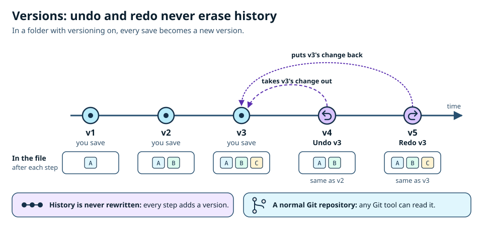

Some things to know:

- Undo goes back one change at a time, newest first.
- Redo puts back the change you undid most recently.
- As soon as you make a new change, the redo list is cleared.
- These buttons work on the whole folder's history. The editor's own undo (<kbd>Ctrl</kbd>+<kbd>Z</kbd> or
  <kbd>Cmd</kbd>+<kbd>Z</kbd> while typing) is separate and only affects the text you are editing.
- Undo, redo and restore are not available in a view-only or locked folder.

## Viewing the history

Open the history in one of these ways:

- click **Version history** at the top of the file pane, or in the **⋯** menu;
- click **History** on the folder's overview;
- click **Open history** on the **Versioning** tab.

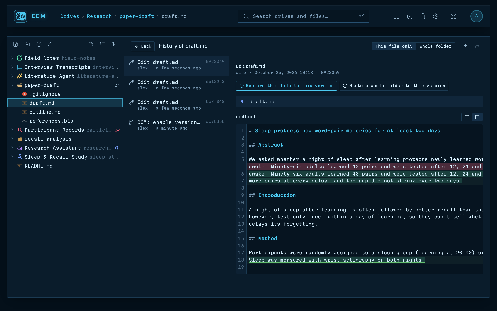

The list on the left shows every version, newest first, with an icon for its kind (change, undo, redo, restore, changed
outside CCM) and when it happened. Choose **This file only** or **Whole folder** to filter it.

Click a version to see what changed: the files, marked as added, modified, deleted or renamed, and the text before and
after. Switch between **Side by side** and **Unified** views.

## Restoring an older version

1. In the history, click the version you want to go back to.
2. Click **Restore this file to this version**, or **Restore whole folder to this version**.
3. Confirm with **Restore file** or **Restore folder**.

The restore is recorded as a new version, so you can undo it too. Restoring a whole folder also removes files that were
added after that version.

## Snapshots

A snapshot is a version with a name you choose, such as "Before reorganising the notes". Click **Create snapshot…** on
the **Versioning** tab, type a name and click **Create snapshot**.

## Turning versioning off

1. On the **Versioning** tab, click **Turn off versioning…**.
2. Choose:
   - **Keep history (archive)**: the history is kept in the folder (in `.ccm/git-archive/`). If you turn versioning on
     again, CCM offers it back;
   - **Delete history permanently**: every earlier version is gone for good. Type `DELETE HISTORY` to confirm.
3. Click the button to confirm.

Your files stay exactly as they are.

# Backups

The Backup page copies folders to a USB stick or external drive, by hand or automatically when you plug the drive in.
This chapter explains the backup modes, profiles, and what happens when a drive is unplugged.

## The Backup page

Click **Backup** in the top bar or on the Drives page. The top of the page shows your computer and every connected drive as a picture.


1. Plug in a USB stick or external drive. It appears in the picture within a few seconds.
2. Unplug it, and it disappears.

Each drive shows its file system and a ring showing how full it is. Click a drive for its menu: **Back up this computer
to this drive…**, **Back up this drive to…** and **Eject**.

Below the picture there are three tabs: **Active jobs**, **Profiles** and **History**.

## Backup modes

| Mode | What it does |
|---|---|
| **Copy** | Copies new and changed files. Nothing on the destination is removed. |
| **Mirror** | Makes the destination match the source: new and changed files are copied, and files that exist only on the destination are moved to its Trash. |
| **Snapshot** | Copies everything into a new dated folder each run, so older versions stay as they were. |


If you're not sure, choose **Copy**. It never removes anything from the drive.

> [!NOTE]
> A mirror never deletes files outright. Files it removes go to the drive's own Trash, where you can restore them in CCM
> while the drive is plugged in. Because a mirror removes files, CCM asks for your password each time it runs.

## Creating a backup profile

A profile remembers what to back up, where to, and how. You can run it again with one click.

1. Click **New profile**. Or drag from your computer to a drive in the picture, or use a drive's menu. The profile
   editor opens with the drives already filled in.
2. Under **Back up this folder**, choose the storage and the folder to back up.
3. Under **Into this folder**, choose the drive and a folder on it. Leave the folder empty to use the drive's top level.
4. Choose a **Mode**.
5. Give the profile a **Name**, or keep the suggested one, such as "Notes → USB".
6. Check the options (see below).
7. Click **Preview** to see what would happen without copying anything.
8. Click **Save**, or **Save and run** to start right away.

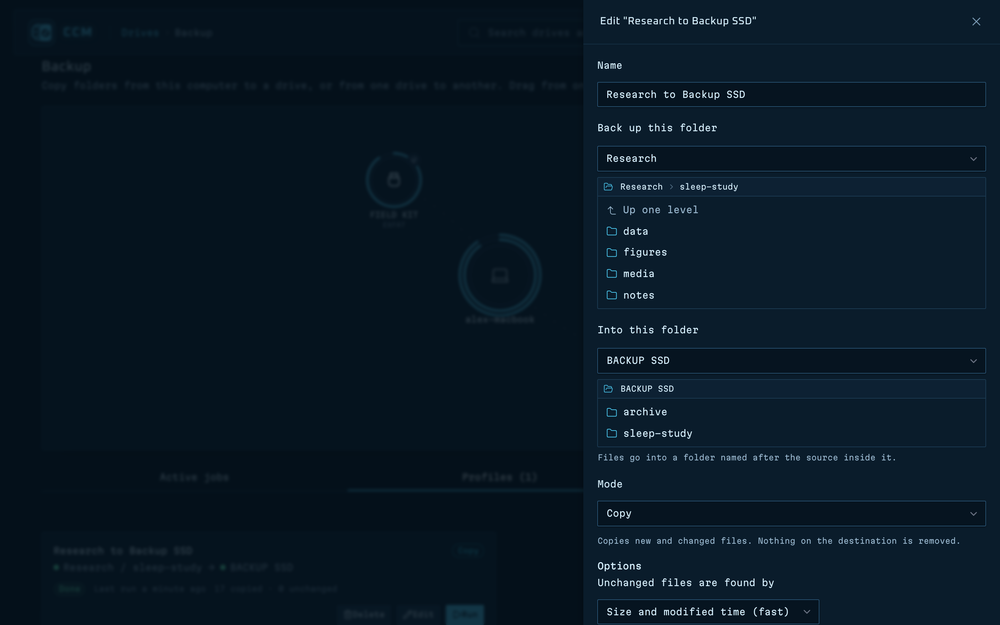

Files go into a folder named after the source inside the destination. For example, backing up "Notes" to a stick
creates a "Notes" folder on the stick. A snapshot adds a dated folder inside it for each run, such as
`2026-10-25_14-30-00`.

### Options

- **Unchanged files are found by**: **Size and modified time (fast)**, or **Contents (reads every file)**, which is
  slower but more thorough.
- **Verify each copy**: reads every copied file back and compares it with the original. Slower, but safest.
- **Include .git folders**: the version history travels with the backup.
- **Leave out**: names or patterns to skip, such as `*.log` or `drafts/**`. Press <kbd>Enter</kbd> after each one.
- **Snapshots to keep** (snapshot mode): older snapshots go to the drive's Trash. Leave it empty to keep all.
- **Run when the drive is plugged in**: runs the backup by itself when you plug in the drive, at most once an hour.
- **Resume when a drive comes back**: a backup paused because a drive was unplugged continues by itself.

## Running a backup

1. Open the **Profiles** tab.
2. Click **Run** on the profile. If one of its drives isn't plugged in, the button says **Connect both drives to run
   this backup**.
3. For a mirror, enter your password and click **Run mirror**.

While it runs, light flows from the source to the drive in the picture, with the speed and the time left. The
**Active jobs** tab shows what it is doing (**Scanning**, **Copying**, **Verifying**) and has **Pause**, **Resume** and
**Cancel** buttons. A message tells you when the backup has finished.

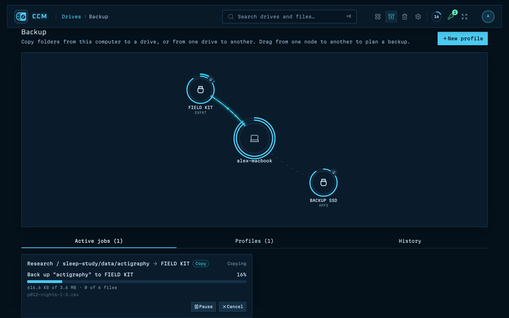

The second time you run a profile, CCM copies only what changed, so it is much faster.

## Automatic backups when you plug in a drive

Turn on **Run when the drive is plugged in** in the profile. From then on, a few seconds after you plug in the drive,
CCM shows **Backup started**, and **Backup finished** when it is done. It recognises the drive even under a different
drive letter, and skips the backup if the profile already ran in the last hour.

## If you unplug a drive during a backup

Nothing breaks. The backup pauses and says **Drive disconnected — will resume when reconnected**. No half-copied files
are left behind. Plug the drive back in and the backup continues where it stopped (with **Resume when a drive comes
back** turned on), or click **Resume** on the **Active jobs** tab.

> [!TIP]
> Before you unplug a drive, click its eject button on the Drives page or choose **Eject** in its menu on the Backup page.
> Wait for the message that you can unplug it.

If you quit CCM during a backup, the backup pauses. Start CCM again, open **Backup**, and click **Resume** on the
**Active jobs** tab.

## History

The **History** tab lists every backup run: when it started and ended, the profile, its status, and how many files it
copied, left unchanged or couldn't copy. Click a run for the details, including every error and warning.

## Things to know

- **Encrypted folders stay encrypted** in a backup. CCM copies them exactly as they are. You need the key file to open
  the backup.
- **Files larger than 4 GB** can't be stored on drives formatted as FAT32, which many USB sticks are. CCM skips them
  and lists a warning in the run's details. Format the drive as exFAT (or another modern format) to back up large files.
- CCM refuses a backup into the folder it is backing up, into an encrypted folder, or into a protected folder.

# Settings

This chapter describes each page of **Settings**. Open it from the top bar, or from the menu under your initials.
Some pages are for admins only.

## General

**Settings › General** shows the app's name, its mode (**Desktop**), the **Data directory** where CCM keeps its database,
and the version number. Admins can also set:

- **Trash › Delete items after**: the number of days after which deleted items are removed for good (0 = never);
- **Viewer and editor**: the largest text file that can be edited (**Edit files up to**, 5 MB by default), and how many
  rows of a CSV table are shown (**Show CSV rows up to**);
- **Strong lock (macOS)**: see the chapter on protection.

## Users and roles

You can add accounts for other people who use this computer. Each person then signs in with their own name and
password.


There are three roles:

| Role | What they can do |
|---|---|
| **Admin** | Everything, including users, storages and every setting. |
| **Editor** | Read and change files in the storages they have access to. |
| **Viewer** | Only read files in the storages they have access to. |

To add a user:

1. Go to **Settings › Users** and click **Add user**.
2. Enter a **Username**, choose a **Role** and enter a **Temporary password**.
3. Click **Create user**.
4. Give the person their temporary password. They choose their own password the first time they sign in.

Click **Manage** next to a user to **Edit role / status** (for example to disable an account), set their **Storage
access** (no access, read, or read and write, per storage), **Reset password**, or **Delete** the account.

## Security and auto-lock

**Settings › Security** lets you:

- **Change password**: enter your current password and a new one;
- set **Auto-lock › Lock after** (admins): how many idle minutes before CCM locks, for every user;
- set **Sign-in lockout** (admins): after too many wrong passwords (5 by default), signing in is blocked for a while (15
  minutes by default);
- see your **Active sessions**.


### When CCM asks for your password

The desktop app never asks you to confirm your password before uploads, downloads or other everyday actions. You are
on your own computer, and you already signed in. (CCM's server edition asks on a network.)


CCM still asks for your password for a few serious actions: unlocking a **Locked** folder, encrypting, unlocking or
decrypting a folder, and running a mirror backup.

## Storages

**Settings › Storages** (admins only) lists the folders and drives CCM shows on the Drives page.


To add a folder from your computer as a storage:

1. Under **Internal storages**, click **Browse…**.
2. Choose the folder in the **Choose a folder** window and click **Choose**.
3. CCM fills in the path and a **Name**. Change the name if you like.
4. Click **Add storage**.

The buttons on each row let you choose **Who can open it**, **Rename** it, hide it from everyone but admins, or remove
it. Removing a storage (**Unregister**) only removes it from CCM. The files stay on disk.

**External drives** lists every drive CCM has seen, even when it is unplugged, so it remembers names and access. Use
**Forget drive** to remove one from the list. **New drives** decides who sees a newly plugged-in drive: **Admins only**
(the default) or **Everyone**.

## Encryption

**Settings › Encryption** lists every encrypted folder, its storage, its state and whether it is unlocked in this
session, and has **Lock all**. Admins can set the **Unlock time**: how long an unlocked folder stays open before CCM
forgets its key (60 minutes by default). See the chapter on encryption.

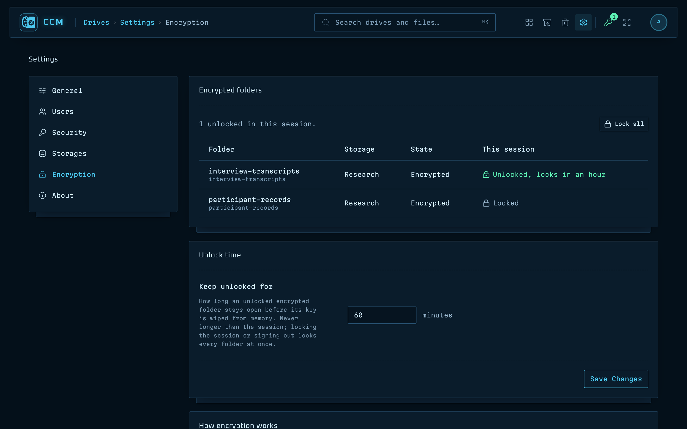

## About and this guide

**Settings › About** shows the product, its version, the mode, and the network note: CCM never contacts the internet.
It also lists the licences of the software CCM is built with.

Under **Guides**, click **Open Desktop Guide** to open this guide as a PDF in a new window. **Open Server Guide** opens
the guide for running CCM on a server. You can also open this guide from the menu bar: **Help › Desktop Guide (PDF)**.


# Troubleshooting and questions

This chapter covers the most common problems and how to solve them.

## I forgot my password

If another admin uses this computer, ask them to reset your password: **Settings › Users › Manage › Reset password**.
They give you a temporary password, and you choose a new one when you sign in.

If you are the only admin, use **Reset CCM**. It removes CCM's accounts and settings and lets you start again.
**It never touches your files or folders.**

1. Let running encryption and backup jobs finish.
2. Open the **Help** menu in the menu bar and choose **Reset CCM…**.
3. Read the message, then click **Reset CCM** (or **Cancel** to change nothing).
4. CCM stops, clears its database and starts again at the setup page.
5. Create a new admin account, as on the first run.

What a reset removes, and what it keeps:

| Removed | Kept |
|---|---|
| User accounts and passwords | All your files and folders |
| Settings (auto-lock, trash, unlock time…) | Memory names, icons and descriptions |
| The list of storages you added | Protection settings |
| Backup profiles and backup history | Encryption (folders stay encrypted) |
| | Version history |

After a reset:

- **Home** comes back by itself. Add your other folders again in **Settings › Storages**.
- **Encrypted folders stay encrypted.** Unlock them as usual with their key file and the password of your **new**
  account. The password only confirms who you are; the key file is what opens the folder.
- Create your backup profiles again.

> [!NOTE]
> A reset can't recover a lost key file. Without the key file, an encrypted folder stays unreadable after a reset too.

## I lost a key file

> [!DANGER]
> There is no way to recover an encrypted folder without its key file. CCM never stored the key, and neither your
> password, an admin nor a reset can replace it.

What you can still do:

- **Look for a copy** of the `.ccmkey` file: on USB drives, in your password manager, in your Downloads folder, in
  email. A copy works exactly like the original.
- **If the folder is still unlocked** in CCM right now, don't lock it, sign out or quit. Copy the files you need out of
  the encrypted folder into a normal folder (CCM asks **Copy out of the encrypted folder?**; choose **Copy and
  decrypt**), or download them as **Decrypted**. This is your last chance: decrypting permanently and re-keying both
  need the key file, so copying the readable files out is the only way to save them.
- **Use readable copies** you made earlier: a decrypted download, files copied out before, or a backup made before the
  folder was encrypted.

Backups made after encryption are encrypted too, and need the same key file.

## A drive doesn't show up

- Wait a few seconds. CCM checks for new drives every two seconds.
- Make sure your computer itself can see the drive, in Finder, File Explorer or Files.
- On **Linux**, a drive may be plugged in but not mounted. Click **Mount** on its card on the Drives page. If there is no
  **Mount** button, mount it in your file manager first.
- On a **Mac**, check that CCM is allowed to access removable volumes: **System Settings › Privacy & Security ›
  Files and Folders**.
- New drives are shown to admins only, unless an admin changed **Settings › Storages › New drives**. Ask an admin to
  give you access to the drive.
- On **Windows**, CCM lists every drive letter except the system drive (usually `C:`) as a drive.

## Versioning says Git is not found

Install Git as described in the chapter on versioning, then click **Check again** in the **Turn on versioning** window.
Git 2.30 or newer is needed. On a Mac, if `git --version` asks you to install the developer tools, install them first.

## I can't edit a file

Hover over the greyed-out **Edit** button to see why. Usually the folder is protected or encrypted and locked, the file
is too large (over 5 MB by default) or not plain text, or your account can only read this storage.

## CCM locked me out after wrong passwords

After too many wrong passwords, sign-in is blocked for a while (15 minutes by default). Wait, then try again.

## CCM stopped unexpectedly

If CCM's local server stops, a message says **CCM stopped unexpectedly.** Choose:

- **Restart CCM** to start it again. Running tasks continue where they stopped;
- **Open Logs** to see what happened;
- **Quit**.

If CCM can't start at all, the message **CCM could not start.** offers **Open Logs** and **Quit**.

## Where the logs are

Logs are text files that record what CCM did. They help find the cause of a problem.

1. Open the **Help** menu and choose **Open Logs Folder**.
2. Your file manager opens the logs folder. It contains:
   - `main.log`: the app window and start-up;
   - `server.log`: CCM's local server.

The logs folder is `logs` inside CCM's data folder (see the next chapter). Old logs are rotated, so they never grow
beyond a few megabytes.

## Questions

**Can my AI tools still use the files?** Yes. They are normal folders on your computer. Only encrypted files can't be
read by other programs, and protected folders can't be changed by them.

**What happens when I close the window?** On Windows and Linux, closing the window quits CCM. On a Mac, choose
**CCM › Quit CCM** or press <kbd>Cmd</kbd>+<kbd>Q</kbd>. Running tasks are paused and can be resumed later.

# Uninstalling, and where your data lives

This chapter explains where CCM keeps its own data, what it leaves in your folders, and how to remove it.

## CCM's own data

CCM keeps its own data in one folder on your computer:

| Computer | CCM's data folder |
|---|---|
| Mac | `~/Library/Application Support/CCM` (in your home folder) |
| Windows | `%APPDATA%\CCM` (usually `C:\Users\<you>\AppData\Roaming\CCM`) |
| Linux | `~/.config/CCM` |

It holds:

- `ccm.db`: the database, with user accounts, settings, the list of storages, and backup profiles and history;
- `config.json`: CCM's basic configuration;
- `logs/`: the log files `main.log` and `server.log`;
- `window-state.json`: the size and position of the window.

It never holds your files or your key files. **Settings › General › Data directory** shows where it is.

## What CCM leaves in your folders

Your own files stay where they are, as normal files. CCM adds a few hidden folders, which it does not show in the file
tree:

- `.ccm/` inside a folder you made into a memory, protected, encrypted or versioned. It holds that folder's settings;
- `.ccm-trash/` at the top of each storage: that storage's Trash;
- `.ccm-tmp/` at the top of each storage: a working area for uploads and saves in progress.

A versioned folder also contains a `.git` folder with its history. It is a normal Git history that other Git tools can
read.

## Before you uninstall

> [!WARNING]
> Uninstalling CCM does not decrypt or unprotect anything. Do these steps first if you won't use CCM again:
>
> - **Decrypt** every encrypted folder (**Folder settings › Encryption › Decrypt permanently…**). Without CCM, encrypted
>   files can't be opened at all.
> - **Remove protection** (set it to **None**) on protected folders. Otherwise their files stay read-only for every
>   program.
> - **Empty the Trash**, or restore what you want to keep. Deleted items stay in the hidden `.ccm-trash` folders.

If you plan to install CCM again later, you can skip these steps: everything works again after reinstalling.

## Uninstalling

**Mac**

1. Quit CCM.
2. Open your **Applications** folder and drag **CCM** to the Trash.

**Windows**

1. Quit CCM.
2. Open **Settings › Apps › Installed apps** (on Windows 10: **Settings › Apps › Apps & features**).
3. Find **CCM** and choose **Uninstall**.

**Linux**

- AppImage: quit CCM and delete the AppImage file.
- deb package: quit CCM and run:

  ```bash
  sudo apt remove ccm
  ```

## Removing CCM's data as well

Uninstalling leaves CCM's data folder in place, so a later install finds your accounts and settings again. To remove
them too, delete the data folder listed above. This is the same as a reset: your own files are not affected.

To remove the hidden `.ccm-trash` and `.ccm-tmp` folders from a storage, empty CCM's Trash first, then delete them in
your file manager (you may need to show hidden files). Don't delete a `.ccm` folder inside an encrypted folder: it holds
the information CCM needs to decrypt it later.
