# Overview

CMM (Context Memory Manager) is a file manager for LLM memory folders, notes and private files. The server
edition runs on an Ubuntu machine in your home lab or office. People on your network use it from a web browser.
Nothing is installed on their computers.

This guide is for the person who installs and looks after the server. It assumes you are comfortable with a
terminal, `sudo` and editing a text file. You don't need to know how CMM works inside.

## What runs where

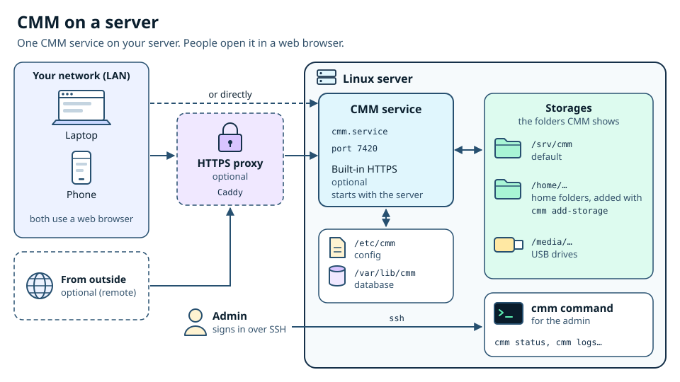

- **The CMM service.** One systemd service called `cmm`, running as the system user `cmm`. It listens on port
  7420 on every network interface by default. It brings its own Node.js runtime, so the server needs no Node,
  npm or other packages.
- **Browsers.** Anyone who can reach the port opens CMM in a browser and signs in with a CMM account. CMM accounts
  are separate from the Linux accounts on the server.
- **An optional reverse proxy.** You can put Caddy (or another proxy) in front of CMM to serve HTTPS. CMM can
  also serve HTTPS itself.
- **Storages.** The folders CMM may show and change. A fresh install creates `/srv/cmm`. You add more with
  `sudo cmm add-storage`. USB drives plugged into the server appear as storages too.

CMM never contacts the internet: there's no telemetry, no update check and nothing is fetched from a CDN. The
installer makes no network calls either, and never runs `apt`, `npm`, `curl` or `wget`. The server can stay
offline for its whole life.

## How the server edition differs from the desktop app

The server and desktop editions share the same interface and features (explorer, editors, memory folders,
protection, encryption, versioning, backups). The differences are about who can reach CMM and how:

| | Desktop app | Server |
|---|---|---|
| Who uses it | The person at the computer | Several people, from browsers on the network |
| Listens on | `127.0.0.1` only, a random port | `0.0.0.0:7420` (configurable) |
| First run | Create the admin account | Create the admin account, after entering a **setup code** |
| Password confirmation | Never | Once per session from the local network; for every protected action from other networks |
| HTTPS | Not needed | Recommended: built-in, your own certificate, or Caddy |
| Storages | Any folder the user can reach | Folders opened to the service with `cmm add-storage` |
| Moving files to the OS trash | Available | Not available (Trash stays inside CMM) |
| Forgotten admin password | Reset CMM | `sudo cmm reset-admin` |
| Logs | A file in the app's data folder | The systemd journal (`journalctl -u cmm`) |

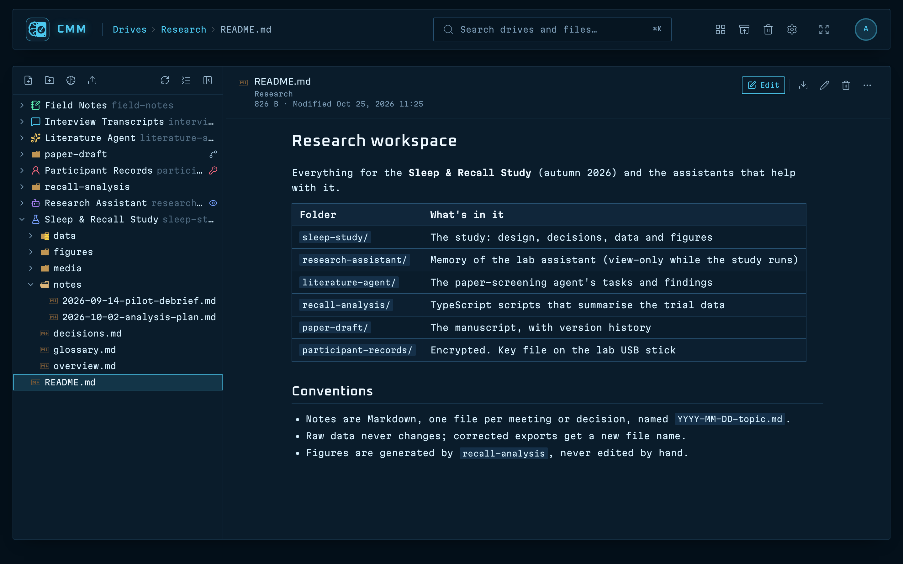

## Where things live

| Path | What it holds |
|---|---|
| `/opt/cmm/<version>` | The program, one folder per installed version |
| `/opt/cmm/current`, `/opt/cmm/previous` | Links to the running version and the one before it |
| `/usr/local/bin/cmm` | The `cmm` admin command (a link into `/opt/cmm/current`) |
| `/etc/cmm/config.json` | The configuration (`0640 root:cmm`) |
| `/etc/cmm/tls/` | The certificate and key made by `cmm gen-cert` |
| `/var/lib/cmm/cmm.db` | The database: users, sessions, storages and access, settings, backup profiles, jobs |
| `/var/lib/cmm/setup-code` | The one-time setup code (deleted when setup is done) |
| `/etc/systemd/system/cmm.service` | The service unit |
| `/etc/systemd/system/cmm.service.d/storage.conf` | The drop-in that opens the storage folders to the service |
| `journalctl -u cmm` | The log |

Your files stay where they are, in the storage folders. CMM keeps its per-folder information (memory settings,
protection, encryption headers) in hidden `.cmm` folders inside them, and its trash in `.cmm-trash` at the top of
each storage.

> [!TIP]
> This guide ships inside the package as `docs/CMM-Server-Guide.pdf`. Once CMM is running, anyone signed in can
> open it from **Settings › About › Open Server Guide**.

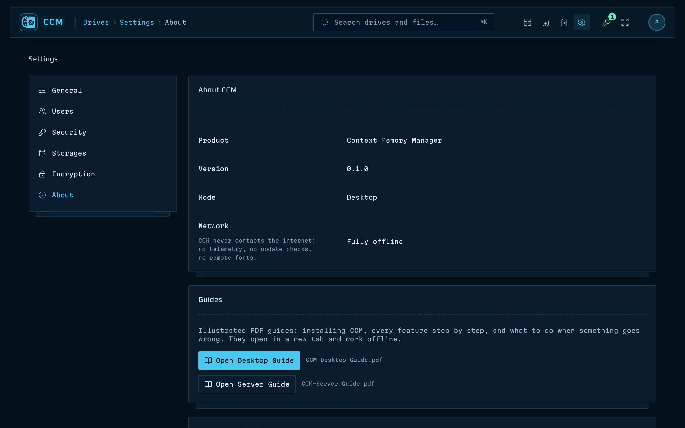

# Requirements

## Operating system

- **Ubuntu Server 22.04 LTS or 24.04 LTS.** Other Debian-family systems with systemd and glibc 2.28 or newer
  should work. The installer refuses anything that isn't Ubuntu or Debian unless you add `--yes`.
- **systemd** must be running. CMM installs as a systemd service; containers without systemd are not supported.
- **x64 (Intel/AMD) or arm64 (ARM)**, with the matching package. Check the machine with:

  ```bash
  uname -m
  ```

  `x86_64` needs the `linux-x64` package, `aarch64` needs the `linux-arm64` package. The installer stops if they
  don't match.

## Memory and disk

| | Size |
|---|---|
| The package (`.tar.gz`) | About 57 MB |
| One installed version in `/opt/cmm` | About 200 MB |
| `/opt/cmm` after an upgrade (current and previous version) | About 400 MB |
| Free space while installing | About 500 MB more (the unpacked package, plus the staging copy) |
| `/var/lib/cmm` | A few MB; it grows slowly with users, jobs and backup history |
| Memory | 2 GB of RAM is a comfortable minimum; that is what the test server had |

The space your files need is on top of this, in the storage folders. Encrypting a folder rewrites its files in
place, and backups need room on the target drive.

## Optional system packages

CMM works without any of these. Each one adds something. On an offline server, copy the `.deb` files over and
install them with `sudo apt install ./<file>.deb`.

| Package | What it adds | Without it |
|---|---|---|
| `acl` (`setfacl`) | `cmm add-storage` grants the `cmm` user access to folders it doesn't own, such as a folder in a home directory | `cmm add-storage` prints `chgrp`/`chmod` commands for you to run instead |
| `udisks2` (`udisksctl`) | USB drives can be mounted, ejected and powered off from inside CMM | Mount drives yourself under `/media` or `/mnt` (see *USB drives on a server*) |
| `git` | Version history for folders | Versioning is switched off, with an explanation in the app |

> [!NOTE]
> Ubuntu Server images don't always include `acl`, and many server installs leave out `udisks2`. Check with
> `command -v setfacl udisksctl git`.

## Network

- A fixed address for the server (a DHCP reservation is enough). People bookmark the URL, and a self-signed
  certificate lists the addresses it was made for.
- Port 7420/tcp reachable from the clients, or 443/tcp if you put Caddy in front.
- A current browser on the client computers: Firefox, Chrome, Edge or Safari.

# Getting the package onto an offline server

CMM ships as one tarball per architecture, with a checksum file next to it:

```text
cmm-server-<version>-linux-x64.tar.gz
cmm-server-<version>-linux-x64.tar.gz.sha256
cmm-server-<version>-linux-arm64.tar.gz
cmm-server-<version>-linux-arm64.tar.gz.sha256
```

You need the pair that matches your server. Copy both files.

## Copy with a USB stick

1. On the computer that has the package, copy the `.tar.gz` and its `.sha256` file to a USB stick.
2. Plug the stick into the server and find its partition:

   ```bash
   lsblk -f
   ```

   Look for the stick's size and file system, for example `sdb1  vfat  MYSTICK`.
3. Mount it and copy the files into your home folder:

   ```bash
   sudo mkdir -p /mnt/stick
   sudo mount /dev/sdb1 /mnt/stick
   cp /mnt/stick/cmm-server-*.tar.gz* ~/
   sudo umount /mnt/stick
   ```

4. Take the stick out.

If the server is reachable over SSH from the computer with the package, `scp` works just as well:

```bash
scp cmm-server-1.1.0-linux-x64.tar.gz cmm-server-1.1.0-linux-x64.tar.gz.sha256 admin@cmm-server:
```

## Check the download

The `.sha256` file holds the SHA-256 checksum of the tarball. Check it before you unpack anything:

1. Go to the folder with both files and run:

   ```bash
   sha256sum -c cmm-server-1.1.0-linux-x64.tar.gz.sha256
   ```

2. You should see:

   ```text
   cmm-server-1.1.0-linux-x64.tar.gz: OK
   ```

> [!WARNING]
> If it says `FAILED`, the file was damaged or changed on the way. Don't install it: copy it again from the
> original.

## Unpack

1. Unpack the tarball and go into the package folder:

   ```bash
   tar -xzf cmm-server-1.1.0-linux-x64.tar.gz
   cd cmm-server-1.1.0-linux-x64
   ```

   Unpacking prints nothing when all is well.
2. Look at what you got:

   ```bash
   ls
   ```

   ```text
   ARCH  BUILD-INFO.txt  README-INSTALL.txt  VERSION  app  bin  deploy  docs  install.sh  node  uninstall.sh
   ```

`README-INSTALL.txt` is a one-page summary of this guide. `deploy/` holds the service unit, the example
configuration, the Caddy example and the USB permission rules. `BUILD-INFO.txt` records how the package was built.

# Installing

## Run the installer

1. From the unpacked package folder, run:

   ```bash
   sudo ./install.sh
   ```

2. Confirm when it asks:

   ```text
   Install CMM 1.1.0 (x64) as the systemd service "cmm"? [y/N] y
   ```

3. Wait for the summary box. The installer starts the service and waits up to 60 seconds for it to answer.

The installer can be run again at any time. Running the same version again repairs an install; running a newer
version upgrades (see *Upgrading and rolling back*).

## Installer options

```bash
sudo ./install.sh [options]
```

| Option | What it does |
|---|---|
| `--port <number>` | The port CMM listens on. Default 7420, or the port already in the config. |
| `--bind <address>` | The address to listen on. Default `0.0.0.0`, every interface. Use `127.0.0.1` behind a proxy on the same machine. |
| `--storage <path>` | A folder CMM may use. Repeat it for more folders. Missing folders are created (`0750 cmm:cmm`). Without any `--storage`, a fresh install creates and uses `/srv/cmm`. |
| `--tls-self-signed` | Make a self-signed certificate and serve HTTPS (the same as `sudo cmm gen-cert`). |
| `--no-start` | Install and enable the service, but don't start it. |
| `--yes`, `-y` | Don't ask for confirmation. Needed when there's no terminal, for example in a script. |
| `--help`, `-h` | Show the options. |

Example: one data folder, HTTPS from the start, no questions:

```bash
sudo ./install.sh --storage /srv/data --tls-self-signed --yes
```

> [!NOTE]
> `--storage` replaces the default `/srv/cmm` only on a **fresh** install. On a server that already has
> `/etc/cmm/config.json`, the config is kept and `--storage` adds folders to it.

## What the installer does

1. **Checks the machine:** it runs as root, systemd is running, the system is Ubuntu or Debian, the architecture
   matches the package, and the bundled Node runtime starts (it needs glibc 2.28 or newer).
2. **Creates the system user `cmm`** (no login shell, home `/var/lib/cmm`) and adds it to the `plugdev` group when
   that group exists.
3. **Copies the program** to `/opt/cmm/<version>`, points `/opt/cmm/current` at it, and links
   `/usr/local/bin/cmm`. It keeps the version you had as `/opt/cmm/previous` and removes anything older.
4. **Writes `/etc/cmm/config.json`** from the example, or keeps the one that is there. It creates `/etc/cmm`
   (`0750 root:cmm`) and `/var/lib/cmm` (`0750 cmm:cmm`).
5. **Opens the storage folders** to the service, the same way `cmm add-storage` does.
6. **Installs the service unit** `/etc/systemd/system/cmm.service` and its storage drop-in.
7. **Sets up USB mounting:** with `udisksctl` present it installs a polkit rule that lets the `cmm` user mount and
   eject drives. Without it, it prints a note.
8. **Makes HTTPS certificates** with `--tls-self-signed`.
9. **Creates the setup code** in `/var/lib/cmm/setup-code` (`0600`, owned by `cmm`).
10. **Enables and starts the service**, waits until it answers, and prints the summary.

## The output

A fresh install without options prints something like this (lines starting with `cmm-install:` come from the
installer; the others come from tools it calls):

```text
cmm-install: created the system user cmm
cmm-install: installed CMM 1.1.0 in /opt/cmm/1.1.0
cmm-install: wrote /etc/cmm/config.json
cmm-install: installed /etc/systemd/system/cmm.service and its storage drop-in
cmm-install: installed the udisks2 polkit rule (CMM can mount and eject USB drives)
Created symlink /etc/systemd/system/multi-user.target.wants/cmm.service → /etc/systemd/system/cmm.service.

+----------------------------------------------------------------------------+
| CMM 1.1.0 is installed and running.                                        |
|                                                                            |
| Open CMM in a browser:                                                     |
|   http://192.168.1.20:7420                                                 |
|                                                                            |
| Setup code (the first page asks for it):                                   |
|   7KQ2-MWXR-9HPT                                                           |
|                                                                            |
| Firewall: if ufw is active, allow the port:                                |
|   sudo ufw allow 7420/tcp                                                  |
|                                                                            |
| Next steps:                                                                |
|   sudo cmm status               check the service                          |
|   sudo cmm add-storage <path>   let CMM use another folder                 |
|   sudo cmm gen-cert             serve HTTPS with a self-signed certificate |
|   sudo cmm logs                 follow the log                             |
+----------------------------------------------------------------------------+
```

The box lists one URL per network interface address. With `--tls-self-signed` the URLs start with `https://`.

Other first lines you may see:

- `cmm-install: USB auto-mount unavailable; mount drives under /media or /mnt manually; see guide §USB` when
  `udisks2` isn't installed. It is repeated under the box. See *USB drives on a server*.
- `cmm-install: created /srv/data` and `Added /srv/data to /etc/cmm/config.json as "data".` for each `--storage`
  folder, followed by `Restart CMM to apply the change: sudo systemctl restart cmm`. You can ignore that last line
  during an install: the installer starts the service itself at the end.

The first line of the box tells you how it went:

| First line | Meaning |
|---|---|
| `CMM 1.1.0 is installed and running.` | All good. |
| `CMM 1.1.0 is installed (not started: sudo systemctl start cmm).` | You used `--no-start`. |
| `CMM 1.1.0 is installed, but it is not answering yet (sudo cmm logs).` | The service didn't answer within 60 seconds. See *Logs and troubleshooting*. |

> [!WARNING]
> The setup code lets whoever has it create the first admin account. Treat it like a password: don't paste it
> into a chat or a ticket, and finish setup soon after installing.

## Check the service

```bash
sudo cmm status
```

```text
CMM:       1.1.0
Installed: 1.1.0
Service:   active
Health:    ok (server mode, version 1.1.0, SQLite 3.53.4, argon2 ok)
Listening: http://0.0.0.0:7420
Open:      http://192.168.1.20:7420
Storages:  1
Setup:     waiting for the setup code (sudo cmm setup-code)
```

`Service` is what systemd reports; `Health` is CMM answering its own health check on this machine. Both must be
good. The service also starts by itself after a reboot.

# First-run setup with the setup code

Until the first admin exists, CMM shows the setup page to every visitor. The setup code makes sure the person who
installed the server, and nobody else on the network, creates that admin.

## Find the setup code

It is in the installer's summary box. To show it again:

```bash
sudo cmm setup-code
```

```text
Setup code: 7KQ2-MWXR-9HPT
Enter it on the first page CMM shows in the browser. It is stored in /var/lib/cmm/setup-code until setup is done.
```

The service also writes a line about it to its log when it starts (`sudo cmm logs`).

If you think someone else has seen the code, replace it:

```bash
sudo cmm setup-code --regenerate
```

The old code stops working straight away.

## Create the admin account

1. On a computer on the same network, open the URL from the summary box, for example `http://192.168.1.20:7420`.
   The setup page opens with a **Server mode** badge.
2. Select **Get started**.
3. Enter the setup code and select **Continue**. Letter case, spaces and dashes don't matter.
4. Choose the **Admin username** (3 to 32 letters, digits, dots, dashes or underscores; stored in lower case).
5. Enter a **Password** and type it again in **Confirm password**. It needs at least 10 characters and can't be the
   username.
6. Select **Continue**.
7. Choose how many idle minutes before a session locks (default 15) and select **Create admin**.
8. When the page says **CMM is ready.**, select **Go to sign in**.

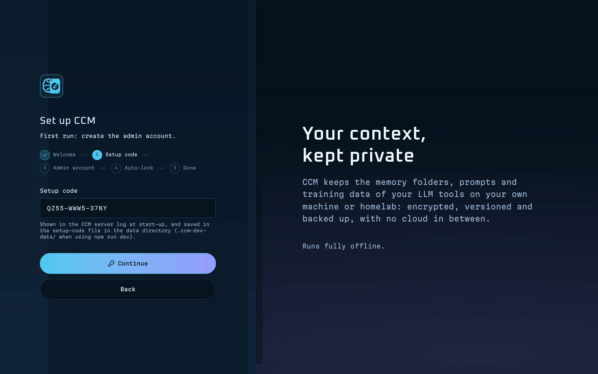

As soon as the admin exists, CMM deletes `/var/lib/cmm/setup-code` and the setup page is gone for good. From then
on, `sudo cmm setup-code` only says:

```text
Setup is complete, so there is no setup code. To recover an admin: sudo cmm reset-admin
```

> [!NOTE]
> Wrong setup codes are rate-limited per address: after a few failed tries, that browser has to wait before trying
> again.

## Sign in

Sign in with the account you just made.

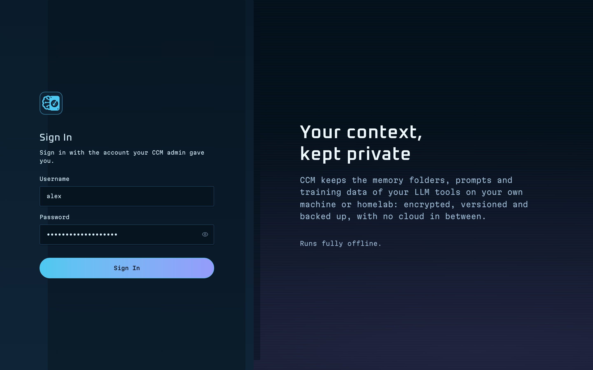

The first time you upload or download a file, CMM asks for your password once more. That is the password
confirmation described in *Security confirmation behaviour*.

Your next steps:

1. Turn on HTTPS (next chapter) before other people start using CMM.
2. Add the folders CMM should manage (*Storages and permissions*).
3. Create accounts for the other people (*Users and roles*).

# HTTPS

Without HTTPS, passwords, session cookies and files cross the network unencrypted. Anyone who can watch the
network can read them. On anything other than a network you fully control, turn HTTPS on.

There are three ways:

| | Self-signed (`cmm gen-cert`) | Your own certificate | Caddy |
|---|---|---|---|
| Effort | One command | Copy two files, edit the config | Install Caddy, edit two configs |
| Works offline | Yes | Yes | Yes (`tls internal`) |
| Browser warning | Yes, until you accept it | No, if your clients trust the issuer | No, once clients trust Caddy's local authority |
| Port | 7420 | 7420 | 443 |

## Option A: a self-signed certificate with cmm gen-cert

1. Run:

   ```bash
   sudo cmm gen-cert
   ```

   To add a DNS name, such as one your router hands out, use `--host`:

   ```bash
   sudo cmm gen-cert --host cmm.home.lan
   ```

2. Note the fingerprint in the output:

   ```text
   Wrote /etc/cmm/tls/cert.pem and /etc/cmm/tls/key.pem, valid until 2029-01-27.
   Names: cmm-server, cmm-server.local, localhost, 127.0.0.1, ::1, 192.168.1.20
   SHA-256 fingerprint: 4F:1C:9A:...:E2:07
   Browsers warn about a self-signed certificate; compare the fingerprint above before you accept it.
   Restarted CMM (if it was running).
   ```

3. Open `https://192.168.1.20:7420` (note the `https`). The plain `http://` address no longer works.

What `gen-cert` does:

- makes an RSA 2048 / SHA-256 certificate, entirely offline;
- names in it: the host name (or `--host`), `<name>.local` when the name has no dot, `localhost`, and every
  interface address of the server (link-local IPv6 addresses are left out);
- writes `/etc/cmm/tls/cert.pem` (`0644`) and `/etc/cmm/tls/key.pem` (`0640 root:cmm`), in a folder that is
  `0750 root:cmm`;
- sets `"tls"` in `/etc/cmm/config.json` and restarts CMM.

Options: `--host <name>` (default: the server's host name) and `--days <n>`, how long the certificate is valid
(default 825, at most 3650). `--no-restart` leaves the restart to you.

> [!TIP]
> The certificate lists the addresses the server had when you ran `gen-cert`. If the server gets a new address or
> name, run `sudo cmm gen-cert` again and accept the new certificate in each browser.

### The browser warning

Because no certificate authority signed the certificate, every browser warns the first time, for example
"Your connection is not private" (Chrome, Edge), "Warning: Potential Security Risk Ahead" (Firefox) or
"This Connection Is Not Private" (Safari). That is expected. The connection is still encrypted; the browser just
can't tell on its own that the certificate is really your server's.

Check it yourself, once per browser:

1. On the warning page, open the certificate details. In Chrome and Edge, select **Not secure** in the address
   bar, then the certificate. In Firefox, select **Advanced**, then **View Certificate**.
2. Find the **SHA-256** fingerprint.
3. Compare it with the `SHA-256 fingerprint` line `gen-cert` printed. To see it again on the server:

   ```bash
   sudo openssl x509 -in /etc/cmm/tls/cert.pem -noout -fingerprint -sha256
   ```

4. If they match, continue to the site (Chrome: **Advanced › Proceed to …**; Firefox: **Accept the Risk and
   Continue**). If they don't match, stop: something between you and the server is answering in its place.

> [!NOTE]
> Under HTTPS, CMM marks its session cookie `Secure`, so the browser never sends it over plain HTTP.

## Option B: your own certificate

Use this when you have a certificate from your own CA or from your organisation. The file must contain the full
chain (your certificate first, then any intermediates), and the key must not have a passphrase.

1. Copy the files into place with the right owners and modes:

   ```bash
   sudo install -d -m 0750 -o root -g cmm /etc/cmm/tls
   sudo install -m 0644 -o root -g root fullchain.pem /etc/cmm/tls/cert.pem
   sudo install -m 0640 -o root -g cmm privkey.pem /etc/cmm/tls/key.pem
   ```

2. Edit the config:

   ```bash
   sudo nano /etc/cmm/config.json
   ```

3. Set the `tls` entry:

   ```json
   "tls": { "certFile": "/etc/cmm/tls/cert.pem", "keyFile": "/etc/cmm/tls/key.pem" }
   ```

4. Check the file and restart:

   ```bash
   sudo cmm status
   sudo systemctl restart cmm
   ```

   `cmm status` reads the config the same way the service does, so a typo shows up there first.

When the certificate is renewed, copy the new files over the old ones and run `sudo systemctl restart cmm`.

## Option C: Caddy as a reverse proxy

Caddy is a web server that can issue certificates from its own local certificate authority, with no internet
access (`tls internal`). Use it if you want CMM on port 443 or already use Caddy for other services.

### Install Caddy offline

1. On a computer with internet access, download the Caddy `.deb` for your architecture from the Caddy releases
   page on GitHub: `caddy_<version>_linux_amd64.deb` for x64, `caddy_<version>_linux_arm64.deb` for arm64.
2. Copy it to the server, the same way you copied CMM.
3. Install it:

   ```bash
   sudo apt install ./caddy_<version>_linux_amd64.deb
   ```

   `apt` installs a local `.deb` without going online. The leading `./` matters: without it, `apt` looks the name up
   in its package lists.

### Point CMM at Caddy

1. Edit `/etc/cmm/config.json` and set:

   ```json
   "bindHost": "127.0.0.1",
   "trustedProxies": ["127.0.0.1"]
   ```

   Leave `"tls": null`: Caddy does HTTPS, and CMM speaks plain HTTP to Caddy on the same machine.
2. Restart CMM:

   ```bash
   sudo systemctl restart cmm
   ```

`bindHost` `127.0.0.1` means CMM only answers on the server itself, so browsers can't go around Caddy.

> [!WARNING]
> `trustedProxies` **must** contain `127.0.0.1`. Only then does CMM believe the client address Caddy passes in
> `X-Forwarded-For` and the `https` scheme in `X-Forwarded-Proto`. Without it, every visitor looks like the server
> itself (loopback), so people on other networks are treated as local and asked for their password only once per
> session, and the session cookie isn't marked `Secure`.

### Configure Caddy

1. Copy the example that ships with CMM:

   ```bash
   sudo cp /opt/cmm/current/deploy/Caddyfile.example /etc/caddy/Caddyfile
   ```

2. Edit `/etc/caddy/Caddyfile` and replace `cmm.example.lan` with the name or address people will use:

   ```text
   cmm.home.lan {
   	tls internal
   	encode gzip
   	reverse_proxy 127.0.0.1:7420 {
   		flush_interval -1
   	}
   }
   ```

   `flush_interval -1` lets large uploads, long downloads and CMM's live updates (Server-Sent Events) through
   without buffering. Keep it.
3. Reload Caddy:

   ```bash
   sudo systemctl reload caddy
   ```

4. Make sure the clients can resolve the name (a DNS entry on your router, or a line in each client's hosts file),
   then open `https://cmm.home.lan`.

To stop the browser warning, make the clients trust Caddy's local authority: copy
`/var/lib/caddy/.local/share/caddy/pki/authorities/local/root.crt` to each client and import it into the system
or browser certificate store.

# Firewall

Ubuntu's firewall, `ufw`, is off by default. Check:

```bash
sudo ufw status
```

If it says `Status: inactive`, there is nothing to do. If it is active, open CMM's port:

```bash
sudo ufw allow 7420/tcp
```

To accept connections only from your local network, name the subnet instead:

```bash
sudo ufw allow from 192.168.1.0/24 to any port 7420 proto tcp
```

With Caddy, open 443 instead (and 80 if you want Caddy to redirect `http://` to `https://`). Port 7420 needs no
rule, because CMM only listens on `127.0.0.1`:

```bash
sudo ufw allow 443/tcp
sudo ufw allow 80/tcp
```

If you used `--port`, use that number instead of 7420.

> [!WARNING]
> If you turn `ufw` on for the first time over SSH, allow SSH **before** `sudo ufw enable`, or you lock yourself
> out: `sudo ufw allow OpenSSH`.

# Storages and permissions

A storage is a folder CMM shows on its Drives page. CMM can only reach folders that both the Linux permissions and
the service's sandbox allow. `sudo cmm add-storage` takes care of both.

## Why a command is needed

CMM runs as the user `cmm` in a hardened systemd unit:

- `ProtectSystem=strict`: the whole file system is read-only for the service, except the folders listed with
  `ReadWritePaths=`: `/var/lib/cmm`, the storage folders, and the drive mount points `/media`, `/mnt` and
  `/run/media`.
- `ProtectHome=read-only`: home folders (`/home`, `/root`) are read-only as well, even where file permissions
  would allow writing.
- And, as for any program, the `cmm` user can only open files that its user, its group or an ACL allows.

`cmm add-storage` lists the folder in the drop-in `/etc/systemd/system/cmm.service.d/storage.conf` (which lifts the
read-only rules for it) and grants the `cmm` user access with ACLs.

## Add a storage

1. Make sure the folder exists:

   ```bash
   sudo mkdir -p /srv/projects
   ```

2. Add it, with the name people will see in CMM:

   ```bash
   sudo cmm add-storage /srv/projects --label "Projects"
   ```

3. Check the output:

   ```text
   Granted cmm read and write access to /srv/projects.
   Added /srv/projects to /etc/cmm/config.json as "Projects".
   Updated /etc/systemd/system/cmm.service.d/storage.conf.
   Registered the storage "Projects".
   Restarted CMM (if it was running).
   ```

4. Reload CMM in the browser. The storage appears on the Drives page for admins. Grant other users access in
   **Settings › Storages** or **Settings › Users** (see *Users and roles*).

Without `--label`, the name is the folder's own name. Running `add-storage` again for the same folder is safe: it
re-applies the access and the drop-in, for example after you restored files with other permissions.

`add-storage` refuses:

- relative paths, folders that don't exist, files, and paths with quotes, backslashes or line breaks;
- system folders: `/`, `/home`, `/root`, `/var`, `/srv`, `/opt`, `/media`, `/mnt` and `/tmp` themselves (a folder
  inside them is fine), and anything inside `/etc`, `/usr`, `/bin`, `/sbin`, `/lib`, `/lib64`, `/boot`, `/proc`,
  `/sys`, `/dev` or `/run`;
- CMM's own folders (`/var/lib/cmm`, `/opt/cmm`, `/etc/cmm`), or a folder that contains one of them.

## What it changes on disk

For a folder the `cmm` user doesn't own, `add-storage` runs `setfacl` to add:

- `user:cmm:rwX` on the folder and everything in it;
- the same entry as a **default** ACL, so new files and folders inherit it;
- `user:cmm:--x` on parent folders the service can't pass through (Ubuntu home folders are `0750`). This lets CMM
  walk through `/home/alex` to reach `/home/alex/notes` without being able to list `/home/alex`.

The owner keeps their own access. Check the result with `getfacl`:

```bash
getfacl /home/alex/notes
```

A folder the `cmm` user already owns, such as one created by `install.sh --storage`, keeps its permissions; the
output then says `/srv/data already belongs to cmm.`

The drop-in lists every storage and the drive mount points. The `-` in front of each path lets the service start
even when a folder (such as one on an unplugged disk) is missing:

```text
# Written by `cmm` from storageRoots in /etc/cmm/config.json. Don't edit it by hand:
# use `sudo cmm add-storage <path>` and `sudo cmm remove-storage <path>`.
[Service]
ReadWritePaths=-/srv/cmm
ReadWritePaths=-/home/alex/notes
ReadWritePaths=-/media
ReadWritePaths=-/mnt
ReadWritePaths=-/run/media
```

## Folders in home directories

Home folders need the most care, because of `ProtectHome=read-only` and the `0750` permissions on `/home/<user>`.
Always add them with the command:

```bash
sudo cmm add-storage /home/alex/notes --label "Alex's notes"
```

```text
Granted cmm read and write access to /home/alex/notes (pass-through on /home/alex).
```

Alex can still read and change everything, including the files CMM creates.

> [!WARNING]
> Don't remove `ProtectHome=read-only` from the unit, and don't edit `cmm.service` to make storages work. Use
> `cmm add-storage`: it opens exactly the folders you choose, and the change survives upgrades, which replace
> `cmm.service`.

## Without the acl package

If `setfacl` isn't installed, `add-storage` still adds the folder to the config and the drop-in, but prints the
permission commands for you instead:

```text
setfacl is not installed (package `acl`), so CMM could not grant itself access. Either install it
and run this command again, or give the cmm group access yourself:
  sudo chgrp -R cmm '/home/alex/notes'
  sudo chmod -R g+rwX '/home/alex/notes'
  sudo find '/home/alex/notes' -type d -exec chmod g+s {} +
  sudo chmod o+x '/home/alex'   # lets CMM pass through
```

Either run them, or install `acl` from a copied `.deb` (`sudo apt install ./acl_*.deb`) and run `add-storage`
again. ACLs are the better choice: they don't change the folder's group or open the home folder to every user.

## Remove a storage

```bash
sudo cmm remove-storage /srv/projects
```

```text
Removed /srv/projects from /etc/cmm/config.json.
Updated /etc/systemd/system/cmm.service.d/storage.conf.
Unregistered the storage at /srv/projects. Its files were not touched.
CMM's access to the files stays until you remove it: sudo setfacl -R -x u:cmm,d:u:cmm '/srv/projects'
Restarted CMM (if it was running).
```

The files are never touched. Run the printed `setfacl` command if you also want to take away the `cmm` user's
access. For a home folder, also remove the pass-through entry on the parent: `sudo setfacl -x u:cmm /home/alex`.

## Storages added in the browser

Admins can also add a folder in **Settings › Storages › Internal storages**: enter the **Folder path on the
server** and a **Name**, then select **Add storage**.

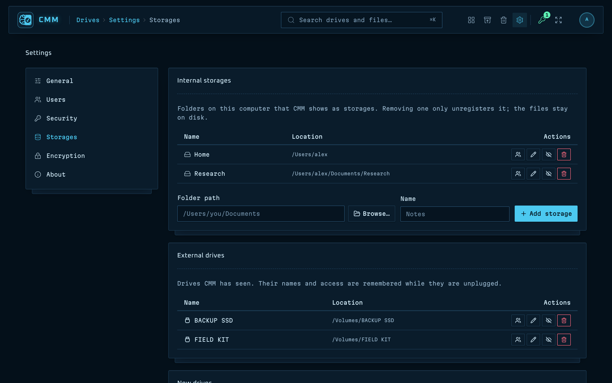

This registers the folder in CMM, but it can't change the service's sandbox or the folder's permissions. The
storage stays **read-only** (or unreadable, if the `cmm` user has no permission) until you run
`sudo cmm add-storage` for the same path on the server.

Likewise, **Unregister** in the browser removes the storage from CMM but leaves it in `config.json` and the drop-in.
Use `sudo cmm remove-storage` to close it completely.

# USB drives on a server

CMM shows USB drives on its Drives page, can back up to them, and can eject them. On a server there is usually no
desktop to mount drives automatically, so how drives appear depends on whether `udisks2` is installed.

Check:

```bash
command -v udisksctl
```

## With udisks2

When `udisksctl` exists, the installer installs a polkit rule that lets the `cmm` user (which has no login
session) mount, unmount, eject and power off drives:

- `/etc/polkit-1/rules.d/50-cmm-udisks.rules`, for polkit 0.106 and newer (Ubuntu 24.04);
- `/etc/polkit-1/localauthority/50-local.d/50-cmm-udisks.pkla`, for the older polkit 0.105 on Ubuntu 22.04,
  which ignores the JavaScript rule. It is installed when `/etc/polkit-1/localauthority` exists.

What users see:

1. Plug in a stick. It appears on the Drives page; admins see it first (see *Users and roles*).
2. If it isn't mounted yet, select **Mount** next to it. udisks2 mounts it under `/media/cmm/<label>`.
3. Work with the files, or back up to it from the **Backup** page.
4. When done, select the eject icon and confirm **Eject**. CMM unmounts the drive and powers it off; it is then
   safe to unplug.

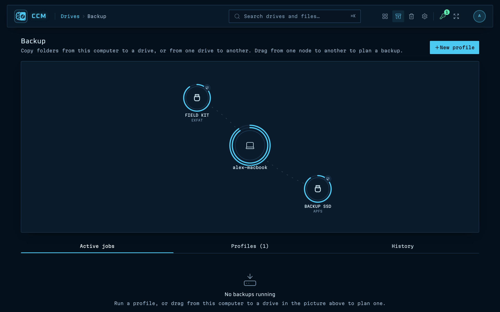

If you install `udisks2` after CMM, run the CMM installer again (the same version is fine) so it adds the polkit
rule.

> [!NOTE]
> The Ubuntu 22.04 `.pkla` rule is part of the package but has had less testing than the 24.04 rule. If **Mount**
> fails on 22.04 with a permission error, check that the `.pkla` file exists and mount manually as described below.

## Without udisks2

This is common on servers. CMM still detects drives that are mounted under `/media` or `/mnt`; you mount them
yourself.

1. Plug in the drive and find its partition:

   ```bash
   lsblk -f
   ```

2. Make a mount point:

   ```bash
   sudo mkdir -p /media/usb
   ```

3. Mount it so the `cmm` user can write to it.

   For FAT32 or exFAT (most sticks), set the owner when mounting:

   ```bash
   sudo mount -o uid=cmm,gid=cmm /dev/sdb1 /media/usb
   ```

   For ext4, mount it and grant access with an ACL:

   ```bash
   sudo mount /dev/sdb1 /media/usb
   sudo setfacl -m u:cmm:rwX /media/usb
   ```

4. Reload CMM in the browser. The drive appears on the Drives page.

To remove it, make sure no copy or backup to it is running in CMM, then:

```bash
sudo umount /media/usb
```

> [!TIP]
> `/media`, `/mnt` and `/run/media` are always writable for the service (they are in the drop-in), so you don't
> need `cmm add-storage` for drives mounted there.

# Security confirmation behaviour

On a server, CMM asks people to confirm their password before sensitive actions. How often depends on where the
browser is.

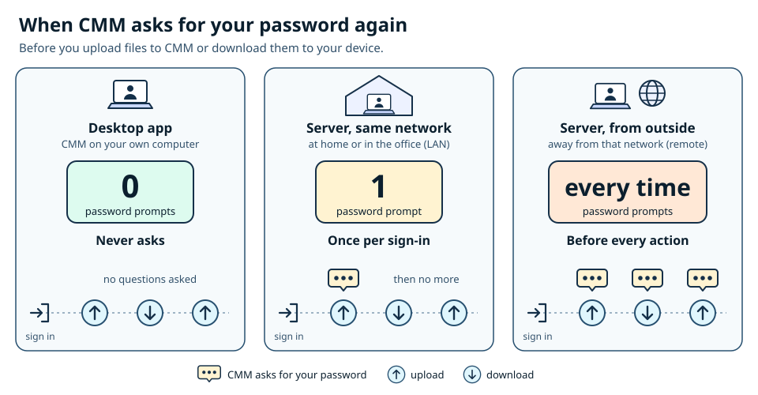

## Local or remote

CMM looks at the address each request comes from:

- **Loopback** (`127.0.0.1`, `::1`): a browser on the server itself.
- **Local network**: an address inside a subnet of one of the server's own network interfaces. If the server is
  `192.168.1.20/24`, every `192.168.1.x` client is local.
- **Remote**: everything else. That includes other subnets behind a router and most VPN clients, whose addresses
  come from their own range.

CMM decides this for every request, so a laptop that moves from the office network to a VPN changes behaviour in
the same session.

## What gets confirmed

| | Loopback or local network | Remote |
|---|---|---|
| Upload files | Once per session | Every time |
| Download files | Once per session | Every time |
| Delete permanently | Once per session | Every time |
| Manage users | Once per session | Every time |
| Manage storages | Once per session | Every time |

- **Once per session**: the first protected action opens a password prompt. After that, the whole session
  (all of the actions above) goes ahead without asking, until the person signs out or the session ends.
- **Every time**: each action needs the password. The confirmation is valid for that one action on that one item,
  for two minutes, and can't be reused.

Admins choose which actions need confirmation in **Settings › Security › Password confirmation (step-up)**. All
five are on by default. The choice applies to both columns.

> [!WARNING]
> Unticking an action means nobody is asked for it, not even from a remote network. Keep at least **Upload files**
> and **Download files** on if the server can be reached from outside your local network.

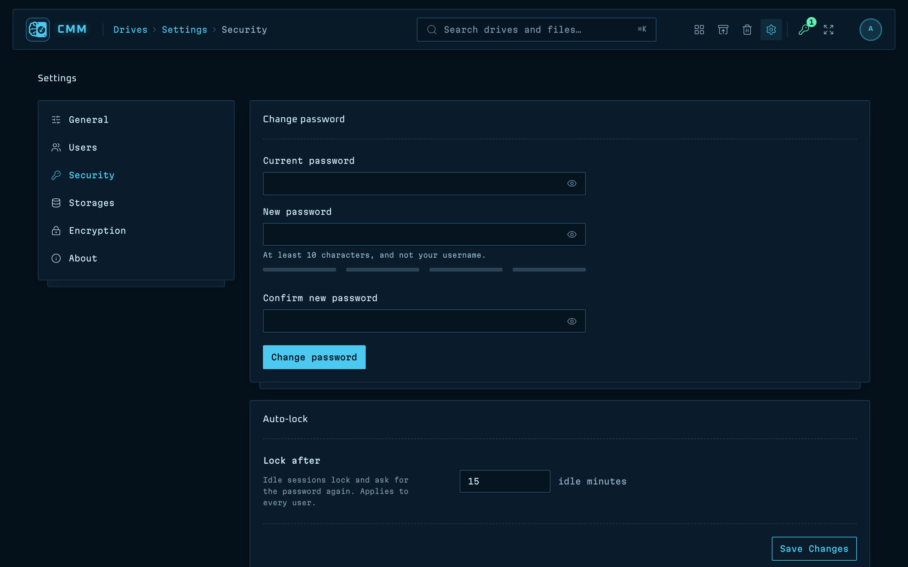

## Proxies and X-Forwarded-For

Behind a reverse proxy, every request comes from the proxy's address. CMM then looks at `X-Forwarded-For` for the
real client, but **only** when the request comes from an address in `trustedProxies` in `/etc/cmm/config.json`.
Entries can be single addresses (`"127.0.0.1"`) or ranges (`"10.0.0.0/24"`). From any other address, the header is
ignored, so a browser can't pretend to be local by sending it.

The same rule applies to `X-Forwarded-Proto: https`, which tells CMM the browser used HTTPS.

> [!DANGER]
> Only list proxies you run yourself, and never a whole client network or `0.0.0.0/0`. Every address in
> `trustedProxies` can claim any client address, including a local one, and so skip the per-action password.

## Other protections

All of these apply to everyone, local or remote:

- **Auto-lock.** An idle session locks after 15 minutes (set during setup, and in **Settings › Security ›
  Auto-lock**). Unlocking needs the password.
- **Session lifetime.** A session ends after 7 days regardless of activity.
- **Sign-in lockout.** After 5 wrong passwords for one username from one address, sign-in, unlocking and password
  confirmation are blocked for that address and username for 15 minutes. Other devices aren't affected. Both
  numbers are in **Settings › Security › Sign-in lockout**. Locks are kept in memory, so restarting CMM clears
  them.
- **Active sessions.** **Settings › Security › Active sessions** lists your sessions with their browser and
  network (**This machine**, **Local network** or **Remote**). Select **Revoke** to end one.

## Encrypted folders on a server

Encrypted folders work the same on a server as on the desktop, and the server never keeps the key.

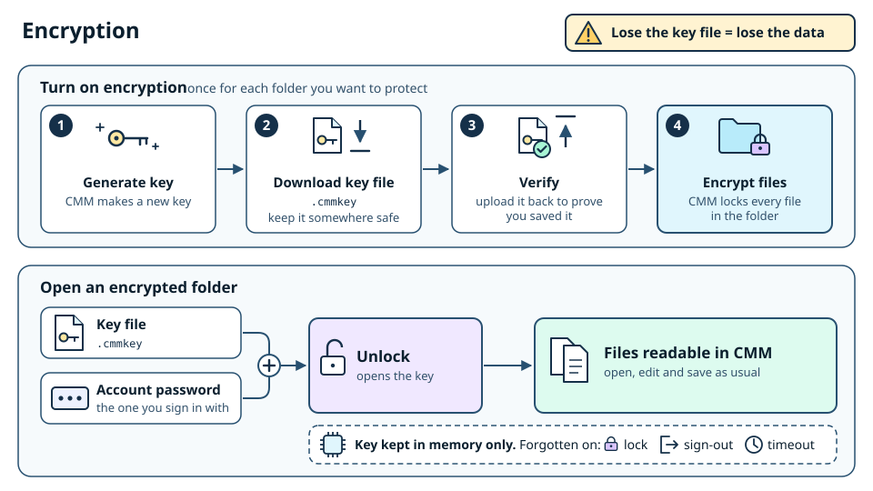

- When someone encrypts a folder, CMM gives them a `.cmmkey` key file to download and keep on their own computer
  (or a USB stick, or a password manager). The server keeps no copy.
- The key file can be protected with a passphrase (chosen in the wizard). The server then also offers a raw
  recovery key file to keep offline; the passphrase itself is never sent anywhere but with the unlock request, and
  never stored.
- To open the folder, they upload the key file from their computer (with its passphrase, if it has one) **and**
  enter their account password. The unwrapped key is then held in the server's memory for that session only.
- The key is wiped when the session locks, when they sign out, when the unlock time runs out (60 minutes by
  default, in **Settings › Encryption**) or when someone selects **Lock all**.
- Decrypted content is never written to the server's disk.

So a stolen server disk, or a backup of it, holds only ciphertext for encrypted folders.

# Terminals

CMM can open terminals in folders, docked along the bottom of the browser window, to run commands or command-line
agents such as Claude Code. On a server they are **off** until an admin turns them on in **Settings › Security ›
Terminals**, which asks for the admin's password.

A terminal is a shell on the server, running as the `cmm` service user, inside the limits of its systemd service. Anyone
who can open one can do anything that user can, so only admins can open terminals. Leave them off unless you need them.

# Users and roles

## Roles

| Role | Can do |
|---|---|
| **Admin** | Everything: every storage, users, settings, storages, drives. |
| **Editor** | Read and write on the storages they've been granted. |
| **Viewer** | Read only on the storages they've been granted, even where write is granted. |

The first account, created during setup, is an admin. CMM always keeps at least one enabled admin: it refuses to
delete, disable or demote the last one.

## Add a user

1. Go to **Settings › Users** and select **Add user**.
2. Enter a **Username**, choose the **Role**, and enter a **Temporary password** (at least 10 characters).
3. Select **Create user**.
4. Give the person the URL, their username and the temporary password, in person or another private way.

At their first sign-in, CMM makes them choose their own password.

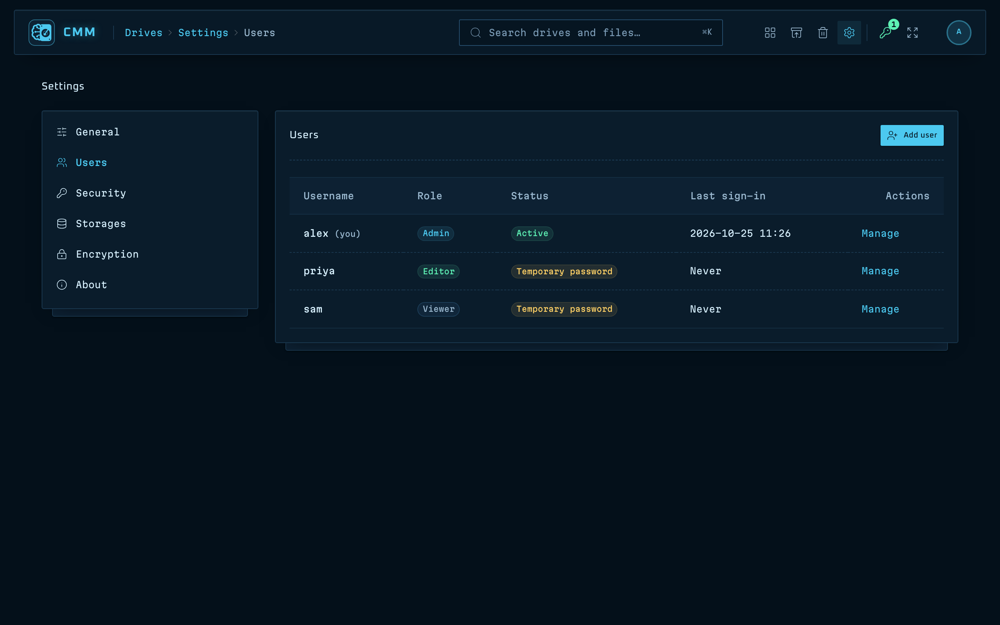

Each user's **Manage** menu has:

- **Edit role / status**: change the role, or tick **Disabled** to block sign-in and end their sessions now.
- **Storage access**: what they can open (below).
- **Reset password**: set a new temporary password; they choose their own at next sign-in.
- **Delete**: remove the account. Their files stay.

On a remote connection, these changes need the password every time (see *Security confirmation behaviour*).

## Grant access to storages

Editors and viewers see only the storages they've been granted. There are two places to set it:

- per user: **Settings › Users › Manage › Storage access**, one row per storage;
- per storage: **Settings › Storages**, the access button (**Who can open it**) on the storage's row, one row per
  user.

For each pair choose **No access**, **Read**, or **Read and write**. Viewers only ever get read access. Admins can
open every storage and don't appear in these lists.

To keep a storage out of sight while you set it up, use **Hide from everyone but admins** on its row.

## New external drives

A USB drive CMM hasn't seen before is visible **to admins only**. That way a stick someone plugs into the server
isn't shown to every user straight away. An admin then grants access per drive, like any storage.

To change this, go to **Settings › Storages › New drives** and set **New drives are visible to**:

- **Admins only (grant access per drive)**, the default;
- **Everyone (editors can write, viewers can read)**.

CMM remembers each drive's name and access while it is unplugged.

## Lost admin password

If an admin forgets their password, another admin can use **Reset password**. If there is no other admin, use the
CLI on the server (see *Logs and troubleshooting*):

```bash
sudo cmm reset-admin <username>
```

# The CMM CLI reference

The `cmm` command manages the server. It is installed as `/usr/local/bin/cmm` and runs with CMM's own Node
runtime. Run it with `sudo`: most commands change system files, and the rest read the database or the config,
which only root and `cmm` can read.

```bash
sudo cmm help
```

## Commands

| Command | What it does | Needs |
|---|---|---|
| `cmm status [--wait <seconds>]` | Shows the version, installed and previous version, service state, health check, listening address, URLs to open, number of storages and setup state. Exit code 0 when CMM answers its health check, 1 when it doesn't. `--wait` keeps checking for up to that many seconds. | `sudo` (without it, storages and setup show as unknown) |
| `cmm reset-admin` | Lists the admins with their last sign-in. | root or `cmm` |
| `cmm reset-admin <username>` | Gives that admin a random 16-character temporary password, ends their sessions and prints the password. Signing in with it forces a new password. Admins only. | root or `cmm` |
| `cmm add-storage <path> [--label <name>]` | Lets CMM use a folder: checks it, grants ACLs, adds it to `config.json`, rewrites the drop-in, registers it and restarts CMM. Safe to repeat. | root |
| `cmm remove-storage <path>` | Stops using a folder: removes it from the config, the drop-in and CMM, and restarts. Never touches the files. Prints the command to remove the ACL. | root |
| `cmm gen-cert [--host <name>] [--days <n>]` | Makes a self-signed certificate (default host: the server's host name; default 825 days, 1 to 3650), turns HTTPS on in the config and restarts. Prints the SHA-256 fingerprint. | root |
| `cmm setup-code` | Prints the first-run setup code (creating one if missing). After setup it says there is none. | root or `cmm` |
| `cmm setup-code --regenerate` | Replaces the setup code with a new one. | root or `cmm` |
| `cmm logs [journalctl options]` | Follows the service log (`journalctl -u cmm -f`). Extra options go to `journalctl`, for example `-n 200`. Stop with <kbd>Ctrl</kbd>+<kbd>C</kbd>. | `sudo` or a user in the `adm` or `systemd-journal` group |
| `cmm rollback` | Switches `/opt/cmm/current` to the previous version and restarts. Run again to go back. | root |
| `cmm version` | Prints the version. | anyone |
| `cmm help` | Prints the list of commands. Also `cmm --help`, `cmm -h`, or `cmm` alone. | anyone |

`add-storage`, `remove-storage`, `gen-cert` and `rollback` restart CMM when it is running. Add `--no-restart` to
any of them to make the change without restarting; the command then prints
`Restart CMM to apply the change: sudo systemctl restart cmm`.

Two options are mostly for the installer: `cmm setup-code --plain` prints only the code, and `cmm write-dropin`
rewrites the storage drop-in from `config.json`.

## Exit codes and errors

| Code | Meaning |
|---|---|
| 0 | Done |
| 1 | The command failed (or, for `status`, CMM didn't answer) |
| 2 | Wrong usage: unknown command or option, a missing path, a number that isn't whole |

Errors start with `cmm:`, for example:

```text
cmm: This needs root. Run: sudo cmm add-storage /srv/projects
cmm: /srv/projects does not exist. Create the folder first.
cmm: There is no previous version to roll back to.
```

## The service itself

The service is managed with the usual systemd commands:

```bash
sudo systemctl status cmm
sudo systemctl restart cmm
sudo systemctl stop cmm
sudo systemctl start cmm
```

## The configuration file

`/etc/cmm/config.json` is plain JSON. `cmm add-storage`, `remove-storage` and `gen-cert` edit it for you; for
anything else, edit it with `sudo nano /etc/cmm/config.json` and run `sudo systemctl restart cmm`.

| Key | Default | Meaning |
|---|---|---|
| `bindHost` | `"0.0.0.0"` | Address to listen on. `0.0.0.0` is every IPv4 interface; `127.0.0.1` only the server itself. |
| `port` | `7420` | Port to listen on. |
| `storageRoots` | `[{ "path": "/srv/cmm", "label": "Server data" }]` | The storage folders and their names. Use `cmm add-storage` rather than editing this. |
| `trustedProxies` | `[]` | Proxy addresses (or ranges) whose `X-Forwarded-For` and `X-Forwarded-Proto` CMM believes. |
| `tls` | `null` | `null` for HTTP, or `{ "certFile": "…", "keyFile": "…" }` for HTTPS. |
| `autoLockMinutes` | `15` | Idle minutes before a session locks, until an admin sets it in the setup wizard or Settings › Security (1 to 1440). |
| `unlockTtlMinutes` | `60` | How long an unlocked encrypted folder stays unlocked, until an admin sets it in Settings › Encryption (1 to 1440). |

CMM refuses to start with an unknown key or a wrong value, and names the problem in the log. `sudo cmm status`
shows the same message, so run it after every edit.

# Backing up CMM itself

There are two separate things to back up:

- **Your files**, in the storage folders. Back them up with CMM's own **Backup** page (to a USB drive) or with
  your usual backup tool.
- **CMM's own state**: `/etc/cmm` and `/var/lib/cmm`. This chapter is about these.

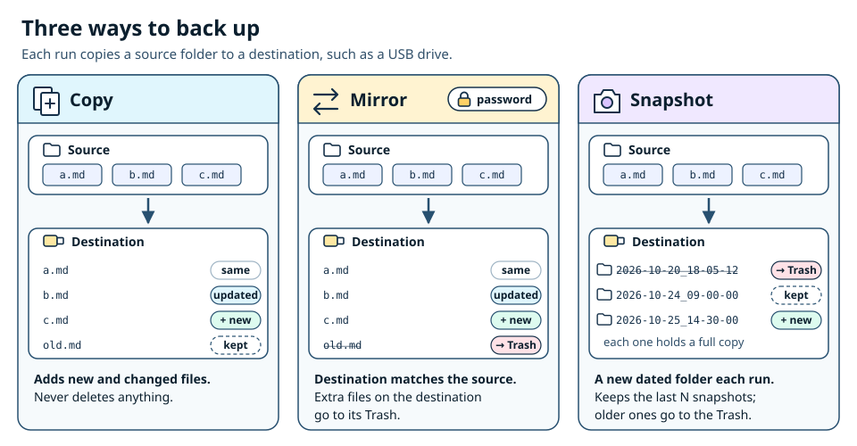

## What's in CMM's folders

| Folder | Contents |
|---|---|
| `/etc/cmm` | `config.json`, and `tls/` with the certificate and its **private key** |
| `/var/lib/cmm` | `cmm.db` (with `cmm.db-wal` and `cmm.db-shm` while running): users and password hashes, sessions, storages and access grants, settings, protection and encryption indexes, backup profiles and history, jobs |

Without them, a reinstall still finds your files, but you'd have to recreate users, grants and settings.

## Make a backup

1. Stop CMM so the database is consistent:

   ```bash
   sudo systemctl stop cmm
   ```

2. Archive both folders, keeping owners and modes:

   ```bash
   sudo tar -czf /root/cmm-state-$(date +%F).tar.gz -C / etc/cmm var/lib/cmm
   ```

3. Start CMM again:

   ```bash
   sudo systemctl start cmm
   ```

4. Copy the archive somewhere safe, off the server.

If the `sqlite3` command is installed, you can copy the database without stopping CMM instead:
`sudo sqlite3 /var/lib/cmm/cmm.db ".backup '/root/cmm.db.bak'"`. Copy `/etc/cmm` alongside it.

> [!WARNING]
> The archive holds the TLS private key and every user's password hash. Store it like you'd store the server
> itself: encrypted, or somewhere only admins can reach.

## Restore

1. Install CMM (the same version, or newer) if it isn't installed.
2. Stop it, remove the current database, put the folders back, and start it:

   ```bash
   sudo systemctl stop cmm
   sudo rm -f /var/lib/cmm/cmm.db /var/lib/cmm/cmm.db-wal /var/lib/cmm/cmm.db-shm
   sudo tar -xzf /root/cmm-state-2026-10-25.tar.gz -C /
   sudo cmm write-dropin --no-restart
   sudo systemctl start cmm
   ```

   Removing the old `cmm.db-wal` and `cmm.db-shm` first matters: leftovers from another database must not be
   applied to the restored one.

`write-dropin` rebuilds the storage drop-in from the restored `config.json`. If the storage folders were restored
from elsewhere too, run `sudo cmm add-storage <path>` for each one to re-apply access.

## Encryption keys are never on the server

> [!DANGER]
> CMM never stores encryption key files on the server: not in `/var/lib/cmm`, not in the database, not in the
> storage folders. A backup of the server can't open an encrypted folder, and neither can you, without the
> `.cmmkey` file. **If every copy of a key file is lost, the folder's contents are lost for good.** Nobody, including
> an admin with root on the server, can recover them. Make sure each person who encrypts a folder keeps their key
> file safe, with a second copy away from the server. Never store key files on the server itself.

# Upgrading and rolling back

## How versions are kept

Each version is installed in its own folder, with two links:

```text
/opt/cmm/1.1.0
/opt/cmm/1.1.0
/opt/cmm/current  -> 1.1.0     what the service runs
/opt/cmm/previous -> 1.1.0     what cmm rollback goes back to
```

The installer keeps the current and the previous version and removes anything older.

## Upgrade

1. Copy the new package to the server and check it with `sha256sum -c`, as in *Getting the package onto an offline
   server*.
2. Unpack it and run its installer:

   ```bash
   tar -xzf cmm-server-1.1.0-linux-x64.tar.gz
   cd cmm-server-1.1.0-linux-x64
   sudo ./install.sh
   ```

3. Look for the upgrade line:

   ```text
   cmm-install: upgrading from 1.1.0 to 1.1.0 (roll back with: sudo cmm rollback)
   ```

4. Check the result:

   ```bash
   sudo cmm status
   ```

   `Installed` should read `1.1.0 (previous: 1.1.0)`.

The upgrade keeps `/etc/cmm/config.json`, `/var/lib/cmm` and the storages. It replaces `cmm.service` and rewrites
the storage drop-in from the config. When CMM starts, it updates its database to the new version by itself.

## Upgrading from CCM

Earlier versions were called **CCM** and installed as the `ccm` service, user and command, with `/etc/ccm` and
`/var/lib/ccm`. The installer of this version moves such an install over by itself, and prints
`found a CCM install; moving it to CMM's names`:

- it stops and removes the `ccm` service, the `ccm` command and the old polkit rule;
- it moves `/etc/ccm` to `/etc/cmm` and `/var/lib/ccm` to `/var/lib/cmm`, and updates the paths in `config.json`;
- it renames the system user and group `ccm` to `cmm`. The user keeps its number, so file owners and the storage
  permissions set by `add-storage` stay valid.

Your storage folders stay where they are, even `/srv/ccm`. When CMM first opens each storage it renames the hidden
`.ccm` folders inside to `.cmm`. The old CCM version is not kept, so `sudo cmm rollback` can't go back to it.

## Roll back

```bash
sudo cmm rollback
```

```text
Switched CMM from 1.1.0 to 1.1.0. Run `sudo cmm rollback` again to go back to 1.1.0.
Restarted CMM (if it was running).
```

Rolling back swaps `current` and `previous`, so running it a second time returns to the newer version.

## Database compatibility

- **Within a minor version** (0.1.x to 0.1.y), database updates only add tables and columns. The previous version
  keeps working on the updated database, so `cmm rollback` is always safe.
- **Across minor versions** (0.1 to 0.2), that isn't promised. Back up CMM's state before upgrading (see *Backing
  up CMM itself*) if you may want to roll back.

To roll back across a minor version, put the old database back as well:

1. Stop CMM:

   ```bash
   sudo systemctl stop cmm
   ```

2. Remove the updated database and restore the backup you made before the upgrade:

   ```bash
   sudo rm -f /var/lib/cmm/cmm.db /var/lib/cmm/cmm.db-wal /var/lib/cmm/cmm.db-shm
   sudo tar -xzf /root/cmm-state-2026-10-25.tar.gz -C /
   ```

3. Switch versions and start:

   ```bash
   sudo cmm rollback --no-restart
   sudo systemctl start cmm
   ```

> [!NOTE]
> Anything people changed in CMM after the backup (new users, grants, settings) is lost with the old database.
> Their files in the storages are not affected.

# Logs and troubleshooting

## Where to look

| Command | Shows |
|---|---|
| `sudo cmm status` | Is the service running, does it answer, on which address, is setup done? |
| `sudo cmm logs` | The log, live. Startup errors are explained here. |
| `sudo journalctl -u cmm -b` | The whole log since the last boot. |
| `sudo journalctl -u cmm --since "1 hour ago"` | The last hour. |
| `sudo systemctl status cmm` | systemd's view, with the last few log lines. |
| `systemd-analyze security cmm` | How tightly the service is sandboxed. |

CMM's own log lines start with `[cmm]`. A healthy start looks like this:

```text
[cmm] database ready in /var/lib/cmm
[cmm] server mode listening on http://0.0.0.0:7420
```

## Admin locked out

If no admin can sign in:

1. List the admins:

   ```bash
   sudo cmm reset-admin
   ```

   ```text
   Admins:
     alex    (last sign-in 2026-10-25T08:14:02.000Z)
   Reset one with: sudo cmm reset-admin <username>
   ```

2. Give one a temporary password:

   ```bash
   sudo cmm reset-admin alex
   ```

   ```text
   Temporary password for alex: hT7mQ2xRk9WbZp4N
   Sign in with it; CMM then asks for a new password. Their other sessions were signed out.
   ```

3. Sign in with it and choose a new password.

If the account is disabled, the command warns you; another admin has to enable it in **Settings › Users**.

If the problem is the **sign-in lockout** (too many wrong passwords), wait for the lock time (15 minutes by
default) or restart CMM, which clears it: `sudo systemctl restart cmm`.

## Common problems

**The browser can't connect.**

- `sudo cmm status`: is `Service` `active` and `Health` `ok`? If not, read `sudo cmm logs`.
- Is the firewall open? `sudo ufw status` (see *Firewall*).
- Is CMM listening on `127.0.0.1` only? `Listening:` in `cmm status` shows it. That is right behind Caddy, but then
  browsers must use Caddy's address.
- Are you using the right scheme? After `cmm gen-cert`, only `https://` works.

**`Health: not reachable … (not listening)` right after a start.** CMM takes a few seconds to start. Use
`sudo cmm status --wait 30`.

**The service keeps restarting and the log says `Invalid CMM config`.** `/etc/cmm/config.json` has a typo, an
unknown key or a wrong value; the message names it. Fix it, check with `sudo cmm status`, then
`sudo systemctl restart cmm`.

**`CMM does not run as root.`** Someone started the server by hand with `sudo`. CMM refuses to run as root,
because files it created would then be unusable by the service. Start it with `sudo systemctl start cmm`.

**`EADDRINUSE` in the log.** Another program uses the port. Find it with `sudo ss -ltnp | grep 7420`, then stop it
or change CMM's `port` in the config (and the firewall rule).

**`failed to start` with an error about `cert.pem` or `key.pem`.** The TLS files in the config are missing or the
`cmm` group can't read the key. Check `ls -l /etc/cmm/tls`: the key must be `-rw-r----- root cmm`. Running
`sudo cmm gen-cert` again makes a fresh pair.

**A storage is read-only, or shows no files.** It was added in the browser, or its permissions changed. Run
`sudo cmm add-storage <path>` for it.

**`setfacl is not installed`.** See *Without the acl package* in *Storages and permissions*.

**`cmm: … is a system folder.`** CMM won't use `/`, `/home`, `/srv` and similar folders themselves. Use a folder
inside them, such as `/srv/cmm` or `/home/alex/notes`.

**A USB drive doesn't appear.** Admins see new drives first; check you're signed in as an admin. Without udisks2,
the drive must be mounted under `/media` or `/mnt` (see *USB drives on a server*). With udisks2, check that the
polkit rule was installed (`ls /etc/polkit-1/rules.d/50-cmm-udisks.rules`).

**People on another network aren't asked for their password every time.** CMM probably sees them as local. If
there's a proxy in front of CMM, `trustedProxies` must list it, or every client looks like the proxy. See
*Proxies and X-Forwarded-For*.

**Everyone is asked for the password on every action, even at the office.** CMM sees them as remote. Either their
subnet isn't one of the server's own (a routed or VPN network), or a proxy forwards addresses CMM doesn't trust.

**The page shows `CMM is starting.`** The service is up but still loading. Wait a few seconds and reload.

**`install.sh` stops with `the bundled Node runtime does not run here`.** The system's glibc is older than 2.28.
Use Ubuntu 22.04 or newer.

**`install.sh` stops with `this package is for arm64, but this machine is x64`.** Use the other package.

**`cmm: This needs root.`** Add `sudo`.

## Asking for help

When you report a problem, include:

```bash
cmm version
sudo cmm status
sudo journalctl -u cmm -b --no-pager | tail -n 100
```

Remove any setup code or temporary password from the output first.

# Uninstalling

The package's `uninstall.sh` removes CMM. It is in the unpacked package folder, and also in
`/opt/cmm/current/uninstall.sh` until it runs.

## Remove the program, keep the data

```bash
sudo ./uninstall.sh
```

```text
Remove the CMM service and program? Config, database and storages are kept. [y/N] y
cmm-uninstall: removed the service, the polkit rule, /usr/local/bin/cmm and /opt/cmm
cmm-uninstall: kept /etc/cmm, /var/lib/cmm, the storages and the cmm user (run with --purge to remove config and data)
```

This stops and disables the service, and removes the unit and its drop-in, the polkit rules, `/usr/local/bin/cmm`
and `/opt/cmm`. Everything else stays. Installing CMM again later picks up the old config and database: users,
grants and settings are all still there.

## Remove everything except your files

```bash
sudo ./uninstall.sh --purge
```

It asks you to type `purge`:

```text
Remove CMM with its config (/etc/cmm), database (/var/lib/cmm) and the cmm user? Storage folders are kept.
Type "purge" to confirm: purge
cmm-uninstall: removed the service, the polkit rule, /usr/local/bin/cmm and /opt/cmm
cmm-uninstall: deleted /etc/cmm
cmm-uninstall: deleted /var/lib/cmm
cmm-uninstall: removed the user cmm
cmm-uninstall: storage folders were not touched:
  /srv/cmm
  /home/alex/notes
```

On top of the plain uninstall, `--purge` deletes `/etc/cmm` (config, certificate and TLS key), `/var/lib/cmm`
(database, setup code) and the `cmm` user and group.

| Option | What it does |
|---|---|
| `--purge` | Also delete `/etc/cmm`, `/var/lib/cmm` and the `cmm` user. |
| `--yes`, `-y` | Don't ask for confirmation (with `--purge`, don't ask for `purge` either). |
| `--help`, `-h` | Show the options. |

> [!NOTE]
> **Storage folders are never deleted, not even with `--purge`.** The script reads the storage list before it
> removes anything, and it keeps `/etc/cmm` or `/var/lib/cmm` if a storage happens to be inside one of them.

## After uninstalling

- Files CMM created in the storages still belong to the old `cmm` user's number. After `--purge`, `ls -l` shows
  that number instead of a name. Give them to someone else if you like, for example
  `sudo chown -R alex: /home/alex/notes`.
- The ACL entries for `cmm` stay on the storage folders. Remove them with
  `sudo setfacl -R -x u:cmm,d:u:cmm <path>` before `--purge` (afterwards, the user name no longer resolves).
- CMM's hidden `.cmm`, `.cmm-trash` and `.cmm-tmp` folders stay in the storages. Files in `.cmm-trash` are files
  people deleted in CMM but didn't empty from the Trash; look through them before you delete that folder.
- Encrypted folders stay encrypted. Decrypt them in CMM before uninstalling if you won't install CMM again, or
  keep the key files: a later CMM install (desktop or server) can open them with the key file and password.
- Undo anything you added for CMM yourself: `ufw` rules (`sudo ufw delete allow 7420/tcp`), Caddy's config, and
  mounts under `/media` or `/mnt`.
